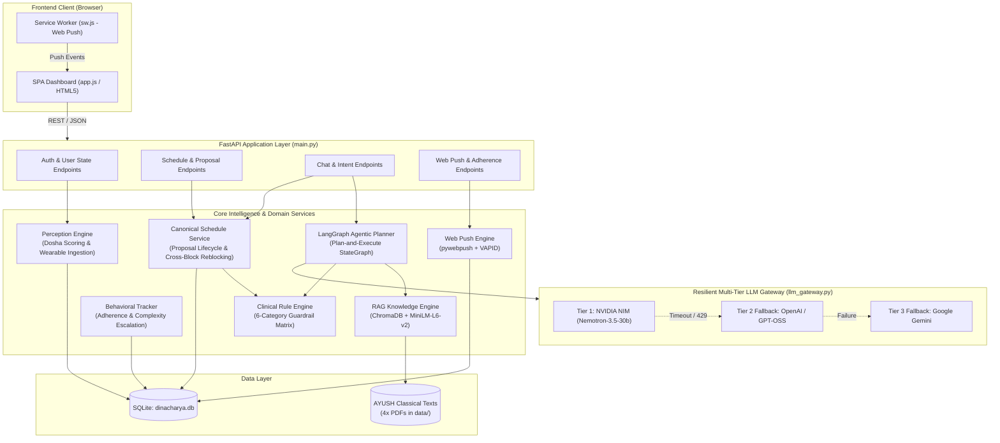
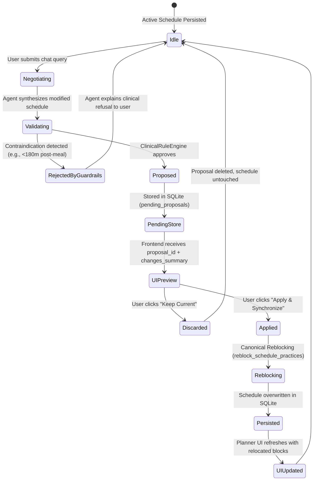

# AI Dincharya (आयुर्वेदिक दिनचर्या)

> **An Intelligent Ayurvedic Wellness Engine, Circadian Schedule Planner, Clinical Safety Guardrails & Web Push Adherence System.**

AI Dincharya bridges classical Ayurvedic wisdom (*Ashtanga Hridaya*, *Charaka Samhita*, and Ministry of AYUSH clinical protocols) with modern biometric telemetry and multi-agent reasoning. It continuously perceives a user's Ayurvedic constitution (*Prakriti* and real-time *Vikriti*), plans an optimal circadian routine (*Dinacharya*), validates every practice against a deterministic 6-category clinical safety matrix, and facilitates synchronized natural-language schedule adaptations with Web Push adherence notifications.

---

## 📑 Table of Contents

1. [System Overview & Architecture](#-system-overview--architecture)
2. [Key Capabilities & Subsystems](#-key-capabilities--subsystems)
3. [Repository Structure](#-repository-structure)
4. [Technology Stack](#-technology-stack)
5. [Prerequisites & Installation](#-prerequisites--installation)
6. [Environment Configuration](#-environment-configuration)
7. [Running the Application](#-running-the-application)
8. [REST API Reference](#-rest-api-reference)
9. [Canonical Schedule Proposals & Cross-Block Rescheduling](#-canonical-schedule-proposals--cross-block-rescheduling)
10. [Ayurvedic Clinical Safety Engine](#-ayurvedic-clinical-safety-engine)
11. [RAG Knowledge Base & Embedding Pipeline](#-rag-knowledge-base--embedding-pipeline)
12. [Testing & Quality Assurance](#-testing--quality-assurance)
13. [RAG & Agent Evaluation Benchmark Suite](#-rag--agent-evaluation-benchmark-suite)
14. [Database Persistence & Evaluation Isolation](#-database-persistence--evaluation-isolation)
15. [CI/CD Pipeline](#-cicd-pipeline)
16. [Troubleshooting & FAQ](#-troubleshooting--faq)

---

## 🏗️ System Overview & Architecture

AI Dincharya utilizes a modular architecture combining a FastAPI web server, a LangGraph multi-node planning workflow, a multi-tier failover LLM gateway, an authentic ChromaDB RAG vector store, an in-memory & SQLite canonical proposal store, and an RFC 8292 VAPID Web Push notification engine.



### Component Dataflow

1. **Constitutional Assessment**: User completes the onboarding questionnaire or streams wearable telemetry (heart rate, HRV, body temperature, sleep stages). The `PerceptionEngine` calculates *Vata*, *Pitta*, and *Kapha* scores and flags current *Vikriti* imbalances.
2. **Knowledge Retrieval**: The `KnowledgeRetriever` performs vector similarity search across chunked classical AYUSH texts in ChromaDB, retrieving authentic guidelines for the user's specific constitution, season (*Ritucharya*), and time of day.
3. **Agentic Routine Planning**: The LangGraph workflow orchestrates routine synthesis via the resilient LLM Gateway, organizing activities into canonical blocks: `morning`, `midday`, `evening`, and `night`.
4. **Deterministic Clinical Guardrails**: Every schedule passes through the `ClinicalRuleEngine` before presentation or persistence, ensuring strict contraindication safety (e.g., Bhuktavastu 180-minute post-meal digestion buffer, fever contraindications).
5. **Interactive Schedule Negotiation**: When users request changes via natural language chat, the backend generates an explicit canonical proposal stored in SQLite. The frontend displays an interactive diff preview, allowing the user to either "Keep Current" or "Apply & Synchronize".
6. **Cross-Block Relocation**: Applying a proposal automatically assigns practices to their correct circadian block based on start times, guaranteeing that evening practices never linger in morning sections.
7. **Adherence & Web Push Delivery**: The background scheduler checks upcoming practices against user subscriptions and delivers native browser notifications via Web Push (RFC 8292).

---

## 🌟 Key Capabilities & Subsystems

| Subsystem | Implementation Module | Primary Responsibilities | Status |
| :--- | :--- | :--- | :--- |
| **Prakriti & Vikriti Perception** | `src/perception/dosha_mapper.py` | Answers-to-dosha scoring, wearable metric ingestion, physiological baseline normalization. | ✅ Production |
| **Multi-Tier LLM Gateway** | `src/llm_gateway.py` | Transparent multi-provider failover (`nvidia` ➔ `openai` ➔ `gemini`), exponential backoff retries, and timeout recovery. | ✅ Production |
| **LangGraph Agentic Planner** | `src/planning/agent.py` | Multi-step Plan-and-Execute agent graph with state persistence and calendar conflict resolution. | ✅ Production |
| **Canonical Schedule Service** | `src/planning/schedule_service.py` | Proposal lifecycle, pending proposal persistence, atomic acceptance/rejection, cross-block practice reblocking. | ✅ Production |
| **Ayurvedic Clinical Guardrails** | `src/safety/guardrails.py` | 6-category relational temporal constraint matrix, Bhuktavastu post-meal gap verification, fever/illness overrides. | ✅ Production |
| **Authentic AYUSH RAG Engine** | `src/knowledge/retriever.py` | ChromaDB vector store, `sentence-transformers/all-MiniLM-L6-v2` embeddings, 4 authentic AYUSH PDFs, multi-query expansion. | ✅ Production |
| **Behavioral Adherence Engine** | `src/behavior/tracker.py` | Habit tracking, adherence scoring, complexity progression (*Anchor* ➔ *Standard* ➔ *Advanced*). | ✅ Production |
| **Web Push Notifications** | `src/notifications/` | RFC 8292 VAPID encryption, service worker push subscriptions, scheduled background dispatch. | ✅ Production |
| **Evaluation & Benchmark Suite** | `src/evaluation/` | CLI runner, 5 evaluation groups (RAG, Grounding, Agent, Safety, Schedule), regression testing against `baseline_v1.json`. | ✅ Production |
| **Interactive Dashboard & SPA** | `src/static/app.js`, `index.html` | Responsive dashboard, live schedule timeline, proposal diff review cards, reasoning inspector, push enablement. | ✅ Production |

---

## 📁 Repository Structure

```
AiDincharya/
├── main.py                     # FastAPI application entry point, route handlers & static mounts
├── requirements.txt            # Project dependencies (FastAPI, LangGraph, ChromaDB, pywebpush)
├── pytest.ini                  # Pytest configuration, custom markers (live_eval), filter rules
├── .env.example                # Canonical environment variable template
├── dinacharya.db               # SQLite application database (auto-initialized on startup)
│
├── src/                        # Core backend package
│   ├── config.py               # Central configuration loader and environment validator
│   ├── models.py               # Pydantic schemas (Schedule, Practice, Proposals, Telemetry)
│   ├── llm_gateway.py          # Resilient multi-tier LLM gateway with timeout & retry policies
│   │
│   ├── database/
│   │   └── db.py               # SQLite schema definitions, connection lifecycle, and CRUD operations
│   │
│   ├── perception/
│   │   └── dosha_mapper.py     # Questionnaire scoring and biometric telemetry ingestion
│   │
│   ├── planning/
│   │   ├── agent.py            # LangGraph multi-node planning workflow & negotiation prompt
│   │   ├── schedule_service.py # Canonical proposal lifecycle, version guarding, cross-block reblocking
│   │   └── tools.py            # Conflict resolution, practice lookup, and time calculation tools
│   │
│   ├── safety/
│   │   └── guardrails.py       # ClinicalRuleEngine & 6-category Relational Temporal Constraint Matrix
│   │
│   ├── behavior/
│   │   └── tracker.py          # Adherence metrics, completion streak logging, complexity escalation
│   │
│   ├── knowledge/
│   │   ├── retriever.py        # ChromaDB RAG retriever with semantic chunking & query expansion
│   │   └── data/               # Authentic AYUSH classical text grounding PDFs:
│   │       ├── Core_Dinacharya_Grounding.pdf
│   │       ├── AYUSH_Common_Yoga_Protocol.pdf
│   │       ├── Dinacharya_Ratricharya_Sante_Clinic.pdf
│   │       ├── MDNIY_AYUSH_Yoga_Mental_Health.pdf
│   │       └── chroma/         # Local persistent ChromaDB vector store
│   │
│   ├── notifications/          # Web Push notification subsystem
│   │   ├── push_service.py     # VAPID payload encryption, subscription store & push dispatcher
│   │   └── generate_vapid_keys.py # Standalone utility to generate RFC 8292 application server keys
│   │
│   ├── evaluation/             # Automated evaluation and benchmarking framework
│   │   ├── runner.py           # CLI evaluation harness with group filtering & baseline comparison
│   │   ├── evaluator.py        # Unified evaluation orchestrator and score aggregator
│   │   ├── metrics/            # Domain metric modules:
│   │   │   ├── rag_metrics.py      # Hit Rate@K, Precision@K, Recall@K, MRR, Abstention Accuracy
│   │   │   ├── agent_metrics.py    # Tool selection accuracy, step efficiency, reasoning coherence
│   │   │   ├── safety_metrics.py   # Guardrail pass rate, contraindication detection, violation rate
│   │   │   └── schedule_metrics.py # Valid schedule rate, chronobiological alignment, slot conflicts
│   │   └── datasets/           # Standardized v1 evaluation benchmarks:
│   │       ├── rag_eval_v1.json
│   │       ├── agent_eval_v1.json
│   │       ├── safety_eval_v1.json
│   │       └── schedule_eval_v1.json
│   │
│   └── static/                 # Single Page Application frontend assets
│       ├── index.html          # Shell container with onboarding, dashboard, and modals
│       ├── style.css           # Modern CSS with dark/light themes and responsive grid
│       ├── app.js              # State machine, proposal preview modal, and API client
│       └── sw.js               # Service Worker for browser push notification handling
│
├── reports/                    # Benchmark and evaluation runs
│   └── eval/
│       └── baseline_v1.json    # Standardized baseline benchmark for CI regression checks
│
├── docs/                       # Architectural specifications & model selection reports
│   ├── SYSTEM_ARCHITECTURE.md
│   ├── MODEL_SELECTION_REPORT.md
│   └── LLM_INVENTORY_AND_REPAIR_PLAN.md
│
├── tests/                      # Pytest automated test suite (16 test modules)
│   ├── test_critical_regressions.py
│   ├── test_cross_block_relocation.py
│   ├── test_database_init.py
│   ├── test_evaluation_framework.py
│   ├── test_implementation_sprint.py
│   ├── test_knowledge_retriever.py
│   ├── test_llm_recovery.py
│   ├── test_perception.py
│   ├── test_planning.py
│   ├── test_post_impl_verification.py
│   ├── test_proposal_synchronization.py
│   ├── test_reschedule_reasoning.py
│   ├── test_routine_persistence.py
│   ├── test_safety.py
│   ├── test_wearable_telemetry_stream.py
│   └── test_web_push.py
│
└── .github/workflows/
    └── ci.yml                  # GitHub Actions CI matrix: pytest + evaluation regression check
```

---

## 💻 Technology Stack

- **Backend Framework**: [FastAPI](https://fastapi.tiangolo.com/) with [Uvicorn](https://www.uvicorn.org/) (ASGI).
- **Agent Orchestration**: [LangGraph](https://github.com/langchain-ai/langgraph) Plan-and-Execute state machines.
- **Data Validation & Schemas**: [Pydantic v2](https://docs.pydantic.dev/).
- **Vector Database & Embeddings**: [ChromaDB](https://www.trychroma.com/) with [sentence-transformers](https://www.sbert.net/) (`all-MiniLM-L6-v2`).
- **Primary LLM Gateway**: [NVIDIA NIM](https://build.nvidia.com/) (`nvidia/nemotron-3.5-lightning-30b-a3b`).
- **Fallback LLM Gateways**: OpenAI-compatible endpoint (`openai/gpt-oss-20b`) & Google Generative AI (`gemini-1.5-flash`).
- **Database & Persistence**: SQLite3 with thread-safe connection pooling and dynamic test isolation.
- **Web Push Engine**: [pywebpush](https://github.com/web-push-libs/pywebpush) & [py-vapid](https://github.com/web-push-libs/py-vapid) implementing RFC 8292.
- **Frontend**: Vanilla JavaScript (ES6+), CSS custom properties, and native Web Service Workers (zero external JS framework dependencies).
- **Testing & Benchmarking**: [Pytest](https://pytest.org/), [HTTPX](https://www.python-httpx.org/), and custom modular evaluation runners.

---

## ⚡ Prerequisites & Installation

### 1. System Requirements

- **Python**: 3.10, 3.11, or 3.12 (Python 3.11 recommended).
- **Git**: Installed and available on your PATH.
- **Modern Web Browser**: Chrome, Edge, Firefox, or Safari (supporting Service Workers and Push API).

### 2. Clone and Setup Environment

#### On macOS / Linux (bash / zsh):

```bash
# Clone the repository
git clone https://github.com/SiddharthAmdal/AIDincharya.git
cd AIDincharya

# Create virtual environment
python3 -m venv .venv
source .venv/bin/activate

# Upgrade pip and install dependencies
pip install --upgrade pip
pip install -r requirements.txt
```

#### On Windows (PowerShell):

```powershell
# Clone the repository
git clone https://github.com/SiddharthAmdal/AIDincharya.git
cd AIDincharya

# Create virtual environment
python -m venv .venv
.\.venv\Scripts\Activate.ps1

# Upgrade pip and install dependencies
python -m pip install --upgrade pip
pip install -r requirements.txt
```

---

## ⚙️ Environment Configuration

Copy the canonical template `.env.example` to `.env`:

```bash
# macOS / Linux
cp .env.example .env

# Windows PowerShell
Copy-Item .env.example .env
```

### Complete Environment Variable Reference

| Variable | Description | Required? | Default Value |
| :--- | :--- | :---: | :--- |
| `LLM_PROVIDER` | Active LLM backend (`nvidia`, `gemini`, or `puter`) | No | `nvidia` |
| `NVIDIA_API_KEY` | NVIDIA Build API Key (from [build.nvidia.com](https://build.nvidia.com/)) | Yes (for NIM) | *None* |
| `NVIDIA_BASE_URL` | Base URL for NVIDIA NIM inference | No | `https://integrate.api.nvidia.com/v1` |
| `DEFAULT_MODEL` | Primary LLM model identifier | No | `nvidia/nemotron-3.5-lightning-30b-a3b` |
| `FALLBACK_MODEL` | Secondary fallback model identifier | No | `openai/gpt-oss-20b` |
| `THIRD_FALLBACK_MODEL`| Tertiary fallback model identifier | No | `gemini-1.5-flash` |
| `GEMINI_API_KEY` | Google AI Studio Gemini API Key | Optional | *None* |
| `GEMINI_BASE_URL` | OpenAI-compatible Gemini gateway endpoint | No | `https://generativelanguage.googleapis.com/v1beta/openai/` |
| `PUTER_BASE_URL` | Alternative Puter.com AI router endpoint | No | `https://api.puter.com/puterai/openai/v1/` |
| `VAPID_PUBLIC_KEY` | RFC 8292 application server public key | Yes (for Push) | *Generated via script* |
| `VAPID_PRIVATE_KEY`| RFC 8292 application server private key | Yes (for Push) | *Generated via script* |
| `VAPID_CLAIMS_EMAIL`| Contact email included in Web Push VAPID claims | Yes (for Push) | `mailto:admin@aidincharya.local` |
| `DINACHARYA_DB_PATH`| Custom SQLite database file path override | No | `dinacharya.db` |
| `PORT` | Local HTTP server port | No | `8000` |
| `DEBUG` | Verbose debug logging toggle (`True`/`False`) | No | `False` |

### Generating Web Push VAPID Keys

To enable native Web Push notifications, generate an authentic cryptographic VAPID keypair using the provided utility:

```bash
python -m src.notifications.generate_vapid_keys
```

This will output:
```text
==================================================
VAPID Public Key:
BL4...[public_key]...=
VAPID Private Key:
...[private_key]...=
==================================================
Add these to your .env file:
VAPID_PUBLIC_KEY=BL4...
VAPID_PRIVATE_KEY=...
VAPID_CLAIMS_EMAIL=mailto:your-email@example.com
```

Paste these three lines into your `.env` file.

---

## 🚀 Running the Application

### Development Mode (with Live Reload)

Run the server with Uvicorn watching for file changes:

```bash
uvicorn main:app --host 0.0.0.0 --port 8000 --reload
```

### Standard / Production Mode

Run directly through Python:

```bash
python main.py
```

### Web Portal Access

- **Web Dashboard**: Open [http://localhost:8000/dashboard](http://localhost:8000/dashboard) (or [http://localhost:8000](http://localhost:8000))
- **Interactive OpenAPI Documentation**: [http://localhost:8000/docs](http://localhost:8000/docs)
- **Alternative ReDoc Documentation**: [http://localhost:8000/redoc](http://localhost:8000/redoc)

---

## 📡 REST API Reference

All requests and responses use standard `application/json` payloads. Session authentication is managed via secure HTTP cookies or bearer session headers.

### 1. Authentication & Onboarding

| Method | Endpoint | Description | Request Payload | Response |
| :--- | :--- | :--- | :--- | :--- |
| `POST` | `/api/auth/register` | Register a new user | `{"username": "...", "password": "...", "email": "..."}` | `{"status": "success", "user_id": "..."}` |
| `POST` | `/api/auth/login` | Authenticate existing user | `{"username": "...", "password": "..."}` | `{"status": "success", "user": {...}}` |
| `POST` | `/api/auth/logout` | Clear user session | *None* | `{"status": "logged out"}` |
| `GET` | `/api/user/state` | Fetch user profile, dosha, & current routine | *None* | `{"onboarded": true, "profile": {...}, "schedule": {...}}` |
| `POST` | `/api/onboarding/questionnaire` | Submit dosha assessment answers | `{"answers": {...}, "telemetry": {...}}` | `{"prakriti": {...}, "vikriti": {...}}` |

### 2. Schedule & Canonical Proposals

| Method | Endpoint | Description | Request / Query | Response |
| :--- | :--- | :--- | :--- | :--- |
| `POST` | `/api/schedule/generate` | Generate initial routine from dosha profile | `{"user_id": "...", "preferences": {...}}` | `Schedule` model |
| `GET` | `/api/schedule/current` | Retrieve active saved schedule | *None* | `{"schedule": Schedule}` |
| `POST` | `/api/schedule/confirm` | Confirm and activate a drafted schedule | `Schedule` model | `{"status": "confirmed"}` |
| `GET` | `/api/schedule/proposal/pending` | Fetch pending proposal and diff preview | *None* | `{"proposal": Proposal, "current_schedule": ...}` |
| `POST` | `/api/schedule/proposal/apply` | Accept proposal, reblock, & persist | `{"proposal_id": "...", "version": 1}` | `{"status": "applied", "schedule": ...}` |
| `POST` | `/api/schedule/proposal/discard` | Discard pending proposal without mutating | `{"proposal_id": "..."}` | `{"status": "discarded"}` |

### 3. Natural Language Chat & Adaptation

| Method | Endpoint | Description | Request Payload | Response |
| :--- | :--- | :--- | :--- | :--- |
| `POST` | `/api/chat` | Send rescheduling or wellness inquiry | `{"message": "Can I do pranayama after lunch?", "current_schedule": {...}}` | `{"reply": "...", "proposed_schedule": {...}, "proposal_id": "...", "changes_summary": [...]}` |
| `GET` | `/api/chat/history` | Retrieve conversation transcript | *None* | `[{"role": "user", "content": "..."}, ...]` |
| `GET` | `/api/insights` | Retrieve dosha-specific lifestyle insights | *None* | `{"insights": [...], "ritucharya": "..."}` |

### 4. Adherence & Web Push Notifications

| Method | Endpoint | Description | Request Payload | Response |
| :--- | :--- | :--- | :--- | :--- |
| `POST` | `/api/adherence/log` | Log practice completion | `{"practice_name": "Abhyanga", "completed": true, "timestamp": "..."}` | `{"status": "logged", "adherence_score": 0.85}` |
| `GET` | `/api/notifications` | Fetch unread in-app notifications | *None* | `[{"id": "...", "title": "...", "read": false}]` |
| `POST` | `/api/notifications/{id}/read` | Mark in-app notification as read | *None* | `{"status": "success"}` |
| `GET` | `/api/notifications/push/vapid-public-key` | Fetch server VAPID public key | *None* | `{"public_key": "BL4..."}` |
| `POST` | `/api/notifications/push/subscribe` | Register browser push subscription | `{"subscription": {"endpoint": "...", "keys": {...}}}` | `{"status": "subscribed"}` |
| `GET` | `/api/notifications/push/status` | Check if user has active push sub | *None* | `{"subscribed": true}` |

---

## 🔄 Canonical Schedule Proposals & Cross-Block Rescheduling

When a user negotiates a schedule change through the natural-language chat interface (e.g., *"Can I shift my Pranayama practice to 18:30 in the evening?"*), AI Dincharya adheres to an explicit, safe, and synchronized proposal lifecycle.



### 1. Proposal Schema & Version Guarding

Proposals are stored in the `pending_proposals` table with the following schema:

```json
{
  "id": "prop_a7b9c1d2e3f4",
  "user_id": "usr_default",
  "version": 1,
  "reasoning": "Pranayama scheduled at 18:30 provides a 270-minute gap after 14:00 lunch, honoring the 180-minute Bhuktavastu digestive window.",
  "changes_summary": [
    "Rescheduled Pranayama from 11:05-11:45 (Morning) to 18:30-18:45 (Evening)"
  ],
  "proposed_schedule": {
    "blocks": [ ... ]
  },
  "created_at": "2026-10-23T15:30:00Z"
}
```

- **Ownership & Stale Guard**: When applying via `POST /api/schedule/proposal/apply`, the backend checks `user_id` and verifies that the client's submitted `version` matches the stored proposal version. If the user sent a newer chat message in between, older proposals are automatically invalidated (`409 Conflict`).

### 2. Cross-Block Relocation Logic

When a practice's start time changes, simply mutating its time within its existing block causes visual and chronobiological bugs (such as an 18:30 practice remaining in the Morning section). 

AI Dincharya implements canonical reblocking via `reblock_schedule_practices()` in `src/planning/schedule_service.py`:

```python
# Canonical Circadian Block Boundaries:
# Morning:  00:00 <= time < 12:00
# Midday:   12:00 <= time < 17:00
# Evening:  17:00 <= time < 21:30
# Night:    21:30 <= time <= 23:59
```

When accepted, practices are dynamically regrouped into their appropriate time-of-day blocks and sorted chronologically, guaranteeing that UI planner sections and persisted database blocks remain completely in sync.

---

## 🛡️ Ayurvedic Clinical Safety Engine

The `ClinicalRuleEngine` in `src/safety/guardrails.py` serves as a deterministic validation gate. No LLM-generated schedule or user proposal is ever persisted without passing this matrix.

### The 6-Category Relational Temporal Constraint Matrix

| Rule Category | Classical Source / Clinical Rationale | Implementation Invariant | Engine Action |
| :--- | :--- | :--- | :--- |
| **1. Bhuktavastu (Post-Meal Gap)** | *Charaka Samhita, Sutrasthana*: Practices involving inversions, abdominal compression, or intense breath control on an undigested stomach (*Aama*) disrupt *Samana Vayu*. | **≥ 180 minutes** gap required between any heavy meal (*Mitahara*, lunch, or dinner) and *Pranayama*, *Asana*, or *Vyayama*. | **Rejection**: Blocks proposal; suggests valid time slot after digestion window. |
| **2. Nava Jwara (Acute Fever)** | *Ashtanga Hridaya, Chikitsasthana*: Heating routines during acute fever drive *Doshas* deeper into the *Dhatus*. | Disallows *Vyayama* (vigorous exercise), *Surya Namaskar*, and *Abhyanga* (oil massage) if body temperature > 37.8°C / 100°F. | **Substitution**: Strips heating practices; injects *Langhana* (digestive rest) and hydration. |
| **3. Pitta Prakopa (Excess Heat)** | High Pitta with symptoms of acid reflux, burning, or skin inflammation. | Disallows heating breathwork (*Kapalabhati*, *Bhastrika*) during peak Pitta midday hours (10:00–14:00). | **Substitution**: Automatically replaces with cooling pranayama (*Sheetali*, *Sitkari*, *Chandra Bhedana*). |
| **4. Vata & Anidra (Insomnia / Anxiety)** | High Vata with fragmented sleep (wearable sleep < 5.5 hours, elevated resting heart rate). | Disallows stimulating evening workouts; mandates grounding bedtime rituals. | **Enforcement**: Injects bedtime *Pada Abhyanga* (foot oil massage) and warm herbal infusion before 21:30. |
| **5. Ajeerna (Indigestion / Low Agni)** | Low HRV, gastrointestinal heaviness, or reported low appetite. | Prevents heavy mid-morning breakfasts or dense dinners. | **Warning / Adjustment**: Reduces meal density; prescribes *Ushnodaka* (warm water sips). |
| **6. Kriya Krama (Morning Sequence)** | Classical circadian sequencing for hygiene and sensory organ purification. | Sequence must respect: *Danta Dhavana* (teeth) ➔ *Jivha Nirlekhana* (tongue scraping) ➔ *Gandusha* (oil pulling) ➔ *Abhyanga* ➔ *Snana* (bath). | **Reordering**: Sorts morning hygiene practices into canonical sequence. |

---

## 📚 RAG Knowledge Base & Embedding Pipeline

AI Dincharya grounds all recommendations in authentic Ayurvedic clinical literature rather than ungrounded LLM hallucinations.

### Grounding Corpus

Stored under `src/knowledge/data/`:
1. `Core_Dinacharya_Grounding.pdf`: Classical principles of daily regimen, seasonal variations, and dosha balancing.
2. `AYUSH_Common_Yoga_Protocol.pdf`: Ministry of AYUSH standardized yogic practices, contraindications, and pacing.
3. `Dinacharya_Ratricharya_Sante_Clinic.pdf`: Clinical guidance on ratricharya (nightly routine) and chronobiology.
4. `MDNIY_AYUSH_Yoga_Mental_Health.pdf`: Morarji Desai National Institute of Yoga protocols for stress and anxiety reduction.

### Embedding & Retrieval Pipeline

- **Embedding Model**: `sentence-transformers/all-MiniLM-L6-v2` (384-dimensional dense vectors running locally on CPU/MPS).
- **Vector Store**: ChromaDB with persistent storage in `src/knowledge/data/chroma/`.
- **Chunking Strategy**: `RecursiveCharacterTextSplitter` with chunk size of 800 characters and 150-character overlap.
- **Query Optimization**: Multi-query expansion transforms colloquial user terms (e.g. *"feeling bloated"*, *"can't sleep"*) into classical Sanskrit and clinical terminology (e.g. *Ajeerna*, *Anidra*, *Vata Shamana*).

---

## 🧪 Testing & Quality Assurance

The repository includes a comprehensive Pytest test suite covering unit tests, clinical safety guardrails, persistence, proposal synchronization, and LLM recovery.

### Running Deterministic Unit & Integration Tests

The standard test suite runs offline and does not require active external API credentials:

```bash
# Run all deterministic tests
pytest -v -m "not live_eval"
```

### Running Specific Test Modules

```bash
# Test cross-block schedule relocation & reblocking logic
pytest tests/test_cross_block_relocation.py -v

# Test proposal generation, synchronization, and version guarding
pytest tests/test_proposal_synchronization.py -v

# Test clinical safety guardrails & Bhuktavastu 180-minute rule
pytest tests/test_safety.py -v

# Test multi-tier LLM gateway timeout handling & fallback recovery
pytest tests/test_llm_recovery.py -v

# Test Web Push notification encryption & subscription storage
pytest tests/test_web_push.py -v

# Test wearable biometric telemetry stream ingestion
pytest tests/test_wearable_telemetry_stream.py -v
```

### Running Opt-In Live NIM Tests

To run end-to-end integration tests against the live NVIDIA NIM API:

```bash
# macOS / Linux
RUN_LIVE_NIM=1 pytest tests/test_proposal_synchronization.py -k test_live_nim -v

# Windows PowerShell
$env:RUN_LIVE_NIM="1"; pytest tests/test_proposal_synchronization.py -k test_live_nim -v; Remove-Item Env:\RUN_LIVE_NIM
```

---

## 📊 RAG & Agent Evaluation Benchmark Suite

The repository contains a standalone, quantitative evaluation harness in `src/evaluation/` designed to benchmark accuracy, safety, and retrieval quality.

### Running the Evaluation CLI

The evaluation runner supports individual group execution or the complete benchmark suite:

```bash
# Run all 5 evaluation groups (RAG, Grounding, Agent, Safety, Schedule)
python -m src.evaluation.runner --group all

# Run specific evaluation groups
python -m src.evaluation.runner --group rag
python -m src.evaluation.runner --group grounding
python -m src.evaluation.runner --group agent
python -m src.evaluation.runner --group safety
python -m src.evaluation.runner --group schedule
```

### Comparing Against Baseline

To measure regressions or improvements against the standardized baseline (`reports/eval/baseline_v1.json`):

```bash
python -m src.evaluation.runner --group all --compare reports/eval/baseline_v1.json
```

### Live Evaluation Mode

By default, the evaluator runs in deterministic offline mode against recorded test benchmarks. To evaluate against the live configured LLM gateway:

```bash
python -m src.evaluation.runner --group all --live
```

### Evaluation Metric Definitions

- **Hit Rate@K**: Percentage of queries where relevant AYUSH passages are retrieved in the top $K$ results.
- **Mean Reciprocal Rank (MRR)**: Average reciprocal rank of the first relevant document.
- **Abstention Accuracy**: Percentage of out-of-domain or unanswerable queries where the engine correctly abstains instead of hallucinating.
- **Safety Pass Rate**: Percentage of generated routines and modifications that fully satisfy the 6-category clinical guardrail matrix.
- **Constraint Violation Rate**: Rate of safety violations (target: `0.0000`).
- **Tool Selection Accuracy**: Proportion of agent steps where the optimal tool was selected.

---

## 💾 Database Persistence & Evaluation Isolation

AI Dincharya uses SQLite for lightweight, zero-configuration local persistence.

### Relational Schema

- `users`: User account credentials (with `bcrypt` password hashing) and profile metadata.
- `user_profiles`: Dosha assessment scores (*Prakriti* & *Vikriti*), primary constitution, and lifestyle preferences.
- `wearable_logs`: Historical biometric telemetry (heart rate, HRV, skin temperature, sleep stage durations).
- `schedules`: Active and historical daily schedules with status flags (`draft`, `confirmed`, `archived`).
- `schedule_practices`: Individual activities linked to parent schedules with assigned circadian block (`morning`, `midday`, `evening`, `night`), timing, and contraindications.
- `pending_proposals`: Active canonical proposals awaiting user confirmation with version tags.
- `chat_history`: Conversation transcripts with role tagging for contextual memory.
- `notifications`: In-app notification queue.
- `push_subscriptions`: RFC 8292 browser push subscription endpoints and client encryption keys (`p256dh`, `auth`).

### Test & Evaluation Isolation

To prevent test runs or benchmark evaluations from polluting or wiping your personal local development database, all test runners and evaluation modules honor the `DINACHARYA_DB_PATH` environment variable:

```bash
# Example running with an isolated temporary database
DINACHARYA_DB_PATH=/tmp/test_dinacharya.db pytest -v
```

---

## 🔄 CI/CD Pipeline

The repository includes a strict continuous integration workflow defined in `.github/workflows/ci.yml`.

Every push and pull request to `main` and `Siddharth` branches executes:

1. **Environment Setup**: Provisions Python 3.11 with pip caching.
2. **Dependency Installation**: Installs all locked dependencies from `requirements.txt`.
3. **VAPID Key Provisioning**: Generates ephemeral CI VAPID keys for Web Push tests.
4. **Deterministic Unit & Integration Tests**: Executes `pytest -v -m "not live_eval"`.
5. **Evaluation Benchmark Run**: Runs `python -m src.evaluation.runner --group all --compare reports/eval/baseline_v1.json`.
6. **Artifact Upload**: Publishes generated evaluation delta reports as workflow artifacts.

---

## ❓ Troubleshooting & FAQ

### 1. `ImportError: cannot import name 'VAPID'` or Web Push Errors
- **Cause**: Missing or incomplete cryptography libraries for Web Push.
- **Resolution**: Run `pip install pywebpush py-vapid` and ensure you generated your keys with `python -m src.notifications.generate_vapid_keys`.

### 2. Browser Notifications Not Arriving
- **Cause**: Browser permissions denied, non-HTTPS host, or mismatched VAPID keys.
- **Resolution**: In local development, Web Push is only supported on `localhost` or `127.0.0.1`. Ensure notifications are allowed in browser site settings and check the Service Worker status in DevTools (`Application > Service Workers`).

### 3. ChromaDB Re-indexing or Memory Warnings
- **Cause**: First-time startup builds the vector database from the 4 AYUSH PDFs in `src/knowledge/data/`.
- **Resolution**: The initial index build takes 15–30 seconds. Once built, embeddings are permanently cached in `src/knowledge/data/chroma/`.

### 4. NVIDIA NIM 429 Rate Limits / Timeout
- **Cause**: Temporary API congestion on the NVIDIA NIM router.
- **Resolution**: The `llm_gateway.py` automatically retries with exponential backoff and transparently falls back to `FALLBACK_MODEL` (`openai/gpt-oss-20b`) or `THIRD_FALLBACK_MODEL` (`gemini-1.5-flash`). You can configure fallback keys in `.env`.

### 5. Rescheduled Practice Appears Under Wrong Time-of-Day Block
- **Cause**: Running an outdated schedule without canonical reblocking.
- **Resolution**: AI Dincharya automatically runs `reblock_schedule_practices()` when accepting proposals. Ensure your browser cache is cleared or hard-refresh (`Cmd+Shift+R` or `Ctrl+F5`) to load the updated `app.js`.

---

## 📄 License & Attribution

This project is developed for educational, clinical research, and personal wellness optimization. Classical Ayurvedic guidelines are grounded in authentic texts published under the guidance of the **Ministry of AYUSH, Government of India**.

