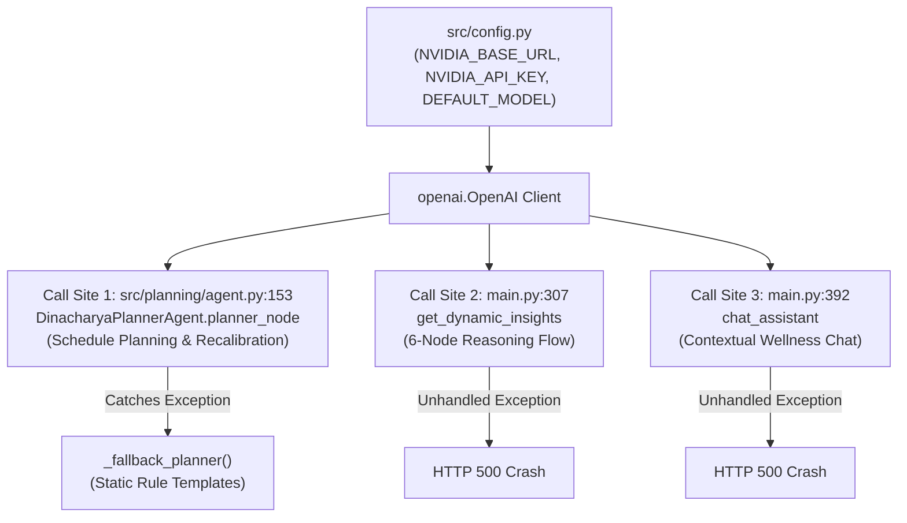

# AI DINCHARYA: LLM RECOVERY & MODEL SELECTION
## Phase 1 Deliverable: Forensic LLM Inventory, Defects & Repair Plan

**Inspection Date:** 2026-10-14  
**Target Repository:** `SiddharthAmdal/AIDincharya`  
**Current Branch:** `Siddharth` (commit `f58c70f`)  
**Assessed Endpoint:** `https://integrate.api.nvidia.com/v1`

---

### 1. Executive Summary

This inventory establishes the baseline architectural state of the LLM subsystem in AI Dincharya prior to benchmark execution and model repair. 

Key findings:
1. **Model EOL Live Outage:** The configured model (`meta/llama-3.1-70b-instruct`) was decommissioned by NVIDIA NIM on **2026-08-26** and returns **HTTP 410 Gone**.
2. **Asymmetric Error Handling:** `DinacharyaPlannerAgent` survives this outage through an internal `_fallback_planner` catching the exception, but `chat` and `insights` endpoints lack fallbacks and crash with **HTTP 500**.
3. **No Model-Driven Tool Calling:** LangChain tools exist in Python (`src/planning/tools.py`), but were never converted to function schemas or passed to the LLM; the application invokes them deterministically in code.
4. **Null-State Crash in Chat:** Newly registered users trigger an unhandled `AttributeError: 'NoneType' object has no attribute 'get'` at `main.py:328` because `last_schedule` is `None` in SQLite.
5. **Missing In-App Notifications:** Notification infrastructure is non-existent; nudges are delivered solely as transient strings in API responses.

---

### 2. LLM Execution Path & Call Site Forensic Inventory

All remote LLM operations in the `Siddharth` branch are channeled through the `openai.OpenAI` SDK configured with NVIDIA NIM or Puter endpoints:



#### Detailed Call Site Specifications:

| Call Site | File Location | Invocation Function | Prompt / Task Description | Target Model Param | Failure Handling |
| :--- | :--- | :--- | :--- | :--- | :--- |
| **Call Site 1** | [`src/planning/agent.py:153`](file:///Users/Siddharth/Documents/AiDincharya/src/planning/agent.py#L153) | `DinacharyaPlannerAgent.planner_node` | Generates 3 daily blocks (morning, midday, evening) grounded in RAG guidelines. | `DEFAULT_MODEL` (`temp=0.0`, `json_object`) | Catches `Exception`, logs error, diverts to `_fallback_planner()`. |
| **Call Site 2** | [`main.py:307`](file:///Users/Siddharth/Documents/AiDincharya/main.py#L307) | `get_dynamic_insights` | Outputs 6 JSON node insights (`node-sleep`, `node-hrv`, etc.) for visual flowchart. | `DEFAULT_MODEL` (`temp=0.0`, `json_object`) | **None.** Unhandled exception raises `HTTPException(status_code=500)`. |
| **Call Site 3** | [`main.py:392`](file:///Users/Siddharth/Documents/AiDincharya/main.py#L392) | `chat_assistant` | Conversational reasoning using user questionnaire, routine, and Vikriti context. | `DEFAULT_MODEL` (`temp=0.7`) | **None.** Unhandled exception raises `HTTPException(status_code=500)`. |

---

### 3. Orchestration, Tools & Knowledge Integration

#### 3.1 LangGraph State Machine
* **Module:** [`src/planning/agent.py`](file:///Users/Siddharth/Documents/AiDincharya/src/planning/agent.py)
* **State Contract:** `AgentState` TypedDict containing `user_id`, `profile`, `context`, `adherence_score`, `complexity`, `retrieved_guidelines`, `completed_today`, `current_time`, `user_instruction`, `current_schedule`, `morning_block`, `midday_block`, `evening_block`, `refinement_logs`, `error`.
* **Topology:** Strictly linear, non-cyclic graph:
  $$\text{retrieve} \longrightarrow \text{plan} \longrightarrow \text{execute} \longrightarrow \text{END}$$
* **Reality:** There are no conditional routing edges or cyclic critique loops.

#### 3.2 Tool Binding Analysis
* **Module:** [`src/planning/tools.py`](file:///Users/Siddharth/Documents/AiDincharya/src/planning/tools.py)
* **Declared Tools:**
  1. `get_weather_context(location: str)`
  2. `check_calendar_conflicts(calendar_events: List[str], candidate_time_slot: str)`
  3. `query_ayurvedic_knowledge(profile: DoshaProfile, context: UserContext)`
* **Forensic Finding:** These functions are standard synchronous Python functions. They are **never registered as OpenAI function calling schemas** and are **never passed in the `tools` parameter** of any LLM API call. The LLM has zero awareness that tools exist; `executor_node` simply calls `check_calendar_conflicts` in Python after the LLM completes.

#### 3.3 RAG Knowledge Pipeline
* **Module:** [`src/knowledge/retriever.py`](file:///Users/Siddharth/Documents/AiDincharya/src/knowledge/retriever.py)
* **Storage & Model:** Persistent ChromaDB collection `grounding_rag_final` with `sentence-transformers` (`all-MiniLM-L6-v2`) dense embeddings.
* **Grounding Source:** 20.9MB PDF (`Core_Dinacharya_Grounding.pdf`) chunked into 140 text segments.
* **Injection Mechanism:** Concatenated formatted string in system prompt:
  ```python
  guidelines_text = "\n".join([f"- {g['text']} (Source: {g['source']})" for g in guidelines])
  ```

---

### 4. Known Defects Verified in Working Tree

1. **DEF-01: Permanent Provider EOL Outage (HTTP 410):**
   * Configured `DEFAULT_MODEL = "meta/llama-3.1-70b-instruct"` is dead.
   * `https://integrate.api.nvidia.com/v1/chat/completions` responds with status 410.
2. **DEF-02: Null-Pointer Crash on New Users (`main.py:328`):**
   * When `last_schedule` is null in SQLite, `state.get("last_schedule", {})` returns `None`.
   * Calling `.get("schedule", {})` on `None` raises `AttributeError: 'NoneType' object has no attribute 'get'`.
3. **DEF-03: Candidate B Unavailability (HTTP 404):**
   * Candidate `nvidia/nemotron-nano-9b-v2` is not present on the hosted NVIDIA endpoint and returns HTTP 404.
4. **DEF-04: Tool Execution Bypass:**
   * Tools are invoked purely via hardcoded application logic rather than autonomous model tool requests.
5. **DEF-05: Missing Notification Persistence:**
   * No notification database table exists. In-app notifications cannot be queued, fetched, or acknowledged.

---

### 5. Reusable Components vs. Files to Modify

#### 5.1 Verified Reusable Components (Keep Unchanged)
* [`src/models.py`](file:///Users/Siddharth/Documents/AiDincharya/src/models.py): Complete Pydantic domain models (`DoshaVector`, `VikritiFlags`, `DoshaProfile`, `UserContext`, `Practice`, `DinacharyaSchedule`).
* [`src/knowledge/retriever.py`](file:///Users/Siddharth/Documents/AiDincharya/src/knowledge/retriever.py): Working vector search with sub-50ms latency.
* [`src/safety/guardrails.py`](file:///Users/Siddharth/Documents/AiDincharya/src/safety/guardrails.py): Deterministic clinical contraindication boundary.
* [`src/behavior/tracker.py`](file:///Users/Siddharth/Documents/AiDincharya/src/behavior/tracker.py): Verified BJ Fogg habit complexity scaling.

#### 5.2 Exact Target Files for Modification

| Target File | Required Remediation / Implementation |
| :--- | :--- |
| [`src/config.py`](file:///Users/Siddharth/Documents/AiDincharya/src/config.py) | Update `DEFAULT_MODEL` to the benchmark winner; configure provider parameters and token budgets. |
| [`src/planning/tools.py`](file:///Users/Siddharth/Documents/AiDincharya/src/planning/tools.py) | Wrap tools with standard OpenAI JSON function schemas; implement execution dispatcher. |
| [`src/planning/agent.py`](file:///Users/Siddharth/Documents/AiDincharya/src/planning/agent.py) | Implement multi-step native tool calling; wire selected model; handle reasoning tokens; support circumstance adaptation. |
| [`main.py`](file:///Users/Siddharth/Documents/AiDincharya/main.py) | Fix null `last_schedule` crash; wrap chat and insights in resilient fallback handlers; add notification API endpoints. |
| [`src/database/db.py`](file:///Users/Siddharth/Documents/AiDincharya/src/database/db.py) | Add `notifications` table schema, migration logic, and CRUD helper methods. |

---
*End of Phase 1 Deliverable.*
