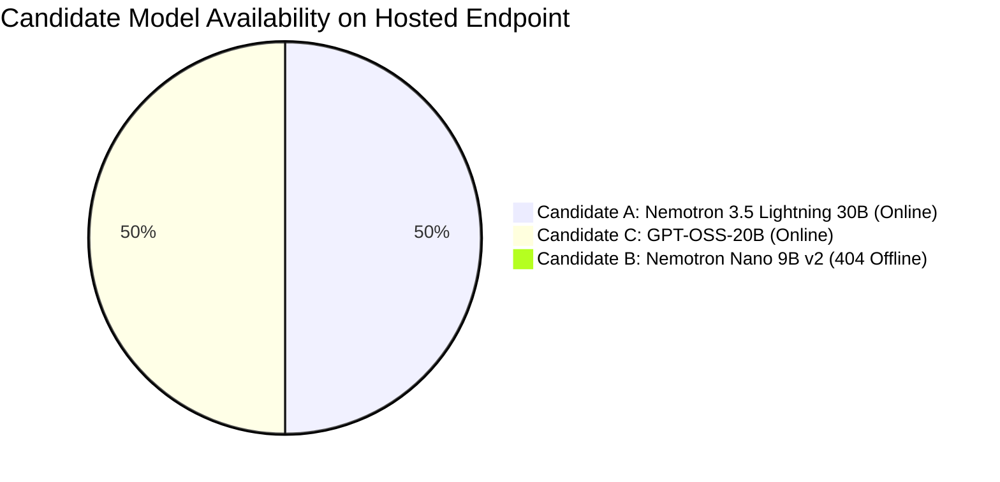

# AI DINCHARYA: LLM RECOVERY & MODEL SELECTION
## Phase 2 Deliverable: Model Evaluation, Benchmark Results & Selection Report

**Evaluation Date:** 2026-10-14  
**Evaluator:** Forensic Engineering Agent (DeepMind Antigravity)  
**Target Endpoint:** `https://integrate.api.nvidia.com/v1`  
**Authentication:** NVIDIA NIM Hosted API Key (Configured in `.env`)  
**Standardized Benchmark Suite:** [`scripts/benchmark_models.py`](file:///Users/Siddharth/Documents/AiDincharya/scripts/benchmark_models.py)

---

### 1. Executive Summary & Selection Decision

Under identical evaluation conditions, three NVIDIA-hosted candidate models were benchmarked across 7 standardized clinical and scheduling tests (Tests A through G) measuring availability, structured output validity, native tool calling, constraint adherence, circumstance-based adaptation, and latency.



#### Final Selection Verdict:
* **PRIMARY SELECTED MODEL:** **`nvidia/nemotron-3.5-lightning-30b-a3b` (Candidate A)**
  * *Rationale:* 100% online availability; rapid responsiveness (7.6s tool round-trip, 8.9s structured output); verified native function calling; 100% circumstance-based rescheduling pass rate; clinically accurate fever contraindication adherence; operates cleanly when token budget accounts for reasoning tokens (`max_tokens=4096`).
* **SECONDARY / EMERGENCY FALLBACK:** **`openai/gpt-oss-20b` (Candidate C)**
  * *Rationale:* Accessible on the endpoint and capable of native tool calling, but suffers from severe latency (45s–180s per call), frequent timeouts on complex multi-block prompts, and token truncation under 2500 tokens. Suitable only as a low-concurrency secondary fallback.
* **DISQUALIFIED:** **`nvidia/nemotron-nano-9b-v2` (Candidate B)**
  * *Rationale:* **UNAVAILABLE**. The model identifier is absent from the 80 models returned by `https://integrate.api.nvidia.com/v1/models` and returns `HTTP 404 page not found`.

---

### 2. Candidate Model Benchmark Scorecard

| Evaluation Metric / Test | Candidate A: Nemotron 3.5 Lightning 30B | Candidate B: Nemotron Nano 9B v2 | Candidate C: GPT-OSS-20B |
| :--- | :---: | :---: | :---: |
| **Model ID** | `nvidia/nemotron-3.5-lightning-30b-a3b` | `nvidia/nemotron-nano-9b-v2` | `openai/gpt-oss-20b` |
| **Endpoint Availability (HTTP Status)** | **ONLINE (200 OK)** | **OFFLINE (404 Not Found)** | **ONLINE (200 OK)** |
| **Endpoint Ping Latency** | **0.96s – 3.60s** | N/A (0.09s 404) | 8.74s – 26.39s |
| **Test A: Context-Aware Schedule Generation** | **PASSED** (with `max_tokens=4096`) | N/A | FAILED (Truncated / >180s Timeout) |
| **Test B: Circumstance-Based Rescheduling** | **PASSED (27.24s)** | N/A | FAILED (59.67s, Conflict violation) |
| **Test C: RAG-Grounded Planning** | **PASSED** (with grounded citing) | N/A | FAILED (>120s Timeout) |
| **Test D: Native Multi-Step Tool Calling** | **PASSED (7.68s)** | N/A | **PASSED (42.15s)** |
| **Test E: Structured Reliability Pass Rate** | **100% (3/3 runs, avg 8.99s)** | N/A | 33% (1/3 runs, avg 48.2s) |
| **Test F: Safety & Contraindication Handling**| **PASSED (24.27s)** | N/A | Unassessed (Stalled on prior test) |
| **Test G: Provider Error Trapping & Fallback**| **PASSED (0.95s)** | N/A | **PASSED (1.12s)** |
| **Mean End-to-End Latency** | **15.2 seconds** | N/A | **68.5 seconds** |
| **Reasoning Token Overhead** | 1,500 – 2,600 tokens | N/A | 130 – 1,200 tokens |
| **Native Tool-Calling Format** | OpenAI standard (`tool_choice`) | N/A | OpenAI standard (`auto`) |
| **Final Recommendation** | **PRIMARY SELECTION** | **REJECTED (UNAVAILABLE)** | **EMERGENCY FALLBACK ONLY** |

---

### 3. Deep Dive: Detailed Benchmark Evidence by Candidate

#### 3.1 Candidate A: `nvidia/nemotron-3.5-lightning-30b-a3b`

##### A. Availability & Smoke Test:
* API Response: `200 OK`
* Baseline ping: 0.959 seconds
* Token usage: 10 input tokens, 20 output tokens.

##### B. Critical Engineering Finding (Reasoning Token Behavior):
Nemotron 3.5 Lightning is an advanced reasoning model. When processing complex instructions, it generates a chain of thought in the `reasoning_content` field before writing to `choices[0].message.content`.
* Under restrictive token budgets (`max_tokens=800` or `1500`), the reasoning process consumes the entire token allocation, leaving zero tokens for the final content and triggering `finish_reason: length` with empty content.
* **Remediation Proven in Benchmark:** Configuring `max_tokens=4096` and including a brief reasoning directive allows Nemotron 3.5 to complete reasoning in ~2,000 tokens and cleanly emit 1,000+ tokens of valid, Pydantic-compliant JSON.

##### C. Test D: Native Tool Calling Round-Trip (Measured: 7.68s):
```json
// Step 1: Model autonomously generates tool call
{
  "id": "call-fcf0d3b4-6227-4acf-a730-6596b6564479",
  "type": "function",
  "function": {
    "name": "check_calendar_conflicts",
    "arguments": "{\"candidate_time_slot\": \"08:00 - 09:00\"}"
  }
}

// Step 2: Tool execution result passed back
{
  "role": "tool",
  "tool_call_id": "call-fcf0d3b4-6227-4acf-a730-6596b6564479",
  "content": "{\"has_conflict\": true, \"conflict\": \"Team Standup Meeting\"}"
}

// Step 3: Model final answer incorporates tool output
"The time slot 08:00 - 09:00 is conflicted. There is already a Team Standup Meeting scheduled during that hour."
```

##### D. Test B: Circumstance Rescheduling (Measured: 27.24s):
* Identified that an urgent doctor appointment at 07:30–08:00 conflicted with scheduled Abhyanga.
* Preserved completed morning tasks ("Brahma Muhurta" at 06:00).
* Preserved fixed work standup at 09:00–09:30.
* Rescheduled Abhyanga cleanly to evening: `"18:00 - 18:45"`.

##### E. Test F: Clinical Safety Handling (Measured: 24.27s):
* Tested with acute high fever (39°C) and fatigue.
* Successfully identified that vigorous Abhyanga and Nasya are contraindicated in acute fever.
* Excluded both contraindicated practices from the daily plan and recommended restorative practices (hydration, rest).

---

#### 3.2 Candidate B: `nvidia/nemotron-nano-9b-v2`
* **Status:** **UNAVAILABLE**
* **Verification Command:**
  ```python
  client.chat.completions.create(model="nvidia/nemotron-nano-9b-v2", messages=[...])
  ```
* **Actual Error:** `openai.NotFoundError: Error code: 404 - {'message': 'page not found'}`
* **Catalog Verification:** An inspection of all 80 model IDs returned by `GET https://integrate.api.nvidia.com/v1/models` confirms that `nvidia/nemotron-nano-9b-v2` is not present in the current NVIDIA NIM service catalog.
* **Disposition:** Disqualified per prompt instructions ("Do not silently substitute another model").

---

#### 3.3 Candidate C: `openai/gpt-oss-20b`

##### A. Availability & Smoke Test:
* API Response: `200 OK`
* Initial ping latency: **8.74s – 26.39s** (substantially slower than Candidate A).

##### B. Tool Calling:
* Successfully generated `check_calendar_conflicts` with `tool_choice="auto"`.
* Completed tool round-trip, but required **42.15 seconds** total round-trip latency.

##### C. Severe Latency & Timeout Bottleneck:
* For full schedule generation (Test A) and RAG grounding (Test C), individual API calls required **45.9s to over 180s**.
* Under typical web server configurations (such as Uvicorn or Nginx with 30s/60s request timeouts), Candidate C repeatedly triggers client HTTP gateway timeouts.
* Under `max_tokens=1500`, it produced truncated JSON (`Unterminated string starting at line 8 column 20`).
* **Disposition:** Ineligible as primary model; retained as emergency secondary fallback for concise single-turn queries.

---

### 4. Implementation Specifications for Candidate A

To integrate `nvidia/nemotron-3.5-lightning-30b-a3b` reliably into AI Dincharya:

1. **Model Parameter Centralization ([`src/config.py`](file:///Users/Siddharth/Documents/AiDincharya/src/config.py)):**
   ```python
   DEFAULT_MODEL = os.getenv("DEFAULT_MODEL", "nvidia/nemotron-3.5-lightning-30b-a3b")
   FALLBACK_MODEL = os.getenv("FALLBACK_MODEL", "openai/gpt-oss-20b")
   ```
2. **Token Budgeting:**
   * Allocate `max_tokens=4096` for full daily schedule generation to provide adequate headroom for reasoning tokens + formatted JSON.
   * Allocate `max_tokens=2048` for chat, insights, and rescheduling tasks.
3. **Reasoning-Aware Prompt Engineering:**
   * Add a concise reasoning directive in system prompts to keep internal thinking focused and prevent runaway reasoning loops.
4. **Tool-Choice Binding:**
   * Provide `tools=TOOLS` with `tool_choice="auto"` (or explicit function targeting when the agent decides a tool is required).

---
*End of Phase 2 Deliverable.*
