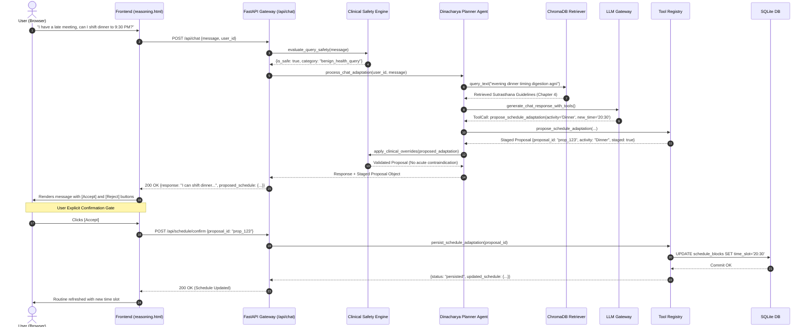

# AI Dincharya — System Architecture Documentation

This document provides a detailed technical architecture overview of the **AI Dincharya** platform, illustrating component relationships, data flow, security boundaries, and runtime interactions.

---

## 1. High-Level System Architecture Diagram

```mermaid
flowchart TB
    subgraph ClientLayer["1. Client Layer (Browser)"]
        UI["Web UI (HTML5 / Vanilla CSS / ES6 JavaScript)"]
        subgraph Pages["Application Pages"]
            P_Home["Landing (index.html)"]
            P_Auth["Auth (login.html, register.html)"]
            P_Dash["Dashboard (dashboard.html)"]
            P_Routine["Routine Manager (routine.html)"]
            P_Chat["Ayurvedic Chat (reasoning.html)"]
        end
        SW["Service Worker (sw.js) - Web Push Handler"]
        UI --- Pages
        UI -.-> SW
    end

    subgraph APILayer["2. API Gateway & Presentation Layer (FastAPI - main.py)"]
        Router["FastAPI Application Router"]
        CORS["CORS Middleware"]
        AuthDep["Auth Dependency (get_current_user)"]
        
        subgraph Endpoints["REST API Endpoints"]
            EP_Auth["/api/auth/* (login, register, logout)"]
            EP_Profile["/api/questionnaire (Prakriti / Onboarding)"]
            EP_Sched["/api/schedule/* (generate, current, mutate, confirm)"]
            EP_Adhere["/api/adherence/* (log, stats)"]
            EP_Chat["/api/chat & /api/chat/history"]
            EP_Push["/api/notifications & /api/notifications/push/*"]
        end
        
        Router --> CORS
        Router --> AuthDep
        Router --> Endpoints
    end

    subgraph SafetyLayer["3. Clinical Safety & Guardrails Engine (guardrails.py)"]
        PriorityGuard["Priority -1 Input Guardrail (evaluate_query_safety)"]
        EmergencyCheck["Acute Emergency Redirection (MI, Stroke, Anaphylaxis, Hemorrhage)"]
        DrugGuard["Pharmaceutical & Statin/Warfarin Stoppage Guard"]
        InjectionGuard["Adversarial Prompt Injection & Exfiltration Firewall"]
        RuleEngine["Clinical Safety Overrides (Post-Processing Engine)"]
        
        PriorityGuard --> EmergencyCheck
        PriorityGuard --> DrugGuard
        PriorityGuard --> InjectionGuard
    end

    subgraph CoreAgentLayer["4. Agent Orchestration & Planning Core"]
        DoshaMapper["Perception Engine (dosha_mapper.py) - Prakriti & Vikriti"]
        PlannerAgent["Dinacharya Planner Agent (agent.py)"]
        Tracker["Adherence Tracker (tracker.py) - Time-Decay Scoring"]
        
        subgraph ToolRegistry["Planner Tool Registry (tools.py)"]
            T_Propose["propose_schedule_adaptation (Staging)"]
            T_Persist["persist_schedule_adaptation (Commit)"]
            T_Adhere["get_adherence_history"]
            T_Conflict["resolve_calendar_conflicts"]
            T_Notify["request_user_notification"]
        end
        
        PlannerAgent --> ToolRegistry
        PlannerAgent --> DoshaMapper
        PlannerAgent --> Tracker
    end

    subgraph RAGLayer["5. Retrieval-Augmented Generation Layer (retriever.py)"]
        ChromaStore[("ChromaDB Vector Store (140 Chunks)")]
        EmbedModel["Embedding Model (all-MiniLM-L6-v2)"]
        CorpusText["Ashtanga Hridaya Sutrasthana (Chapters 1-4)"]
        DistanceGate["Cosine Distance Separability Gate (Threshold >= 0.68)"]
        
        CorpusText --> EmbedModel --> ChromaStore
        DistanceGate --> ChromaStore
    end

    subgraph LLMLayer["6. LLM Gateway & Resiliency Layer (llm_gateway.py)"]
        Gateway["LLM Gateway (Multi-Attempt Retry & JSON Parser)"]
        PrimaryNIM["Primary Provider: NVIDIA NIM (Llama-3.1-70b-Instruct)"]
        FallbackPlanner["Deterministic Ayurvedic Rule-Based Fallback Planner"]
        
        Gateway --> PrimaryNIM
        Gateway -.->|"On Timeout / Error"| FallbackPlanner
    end

    subgraph StorageLayer["7. Persistence & State Storage Layer (db.py)"]
        SQLiteDB[("SQLite Database (dinacharya.db)")]
        
        subgraph Tables["Relational Tables"]
            T_Users["users & user_sessions"]
            T_Profiles["dosha_profiles & user_contexts"]
            T_Schedules["schedules & schedule_blocks"]
            T_Logs["adherence_logs"]
            T_Chat["chat_history"]
            T_Notifs["notifications & web_push_subscriptions"]
        end
        
        SQLiteDB --- Tables
    end

    subgraph PushSubsystem["8. Notification & Web Push Subsystem (service.py)"]
        NotifService["Notification Service (service.py)"]
        InAppTray["In-App Notification Tray"]
        WebPushLib["pywebpush (VAPID RFC 8291 / RFC 8292)"]
        PushService["Browser Push Service (FCM / Mozilla / Apple Push)"]
        
        NotifService --> InAppTray
        NotifService --> WebPushLib
        WebPushLib --> PushService
    end

    %% Data flow connections
    ClientLayer <==>|"HTTPS / REST API"| APILayer
    EP_Chat --> PriorityGuard
    PriorityGuard -->|"Safe Queries"| PlannerAgent
    PriorityGuard -->|"Unsafe / Emergency"| ClientLayer
    
    EP_Sched --> PlannerAgent
    PlannerAgent --> RAGLayer
    PlannerAgent --> Gateway
    Gateway --> RuleEngine
    RuleEngine --> StorageLayer
    
    ToolRegistry -->|"Validated Commit"| StorageLayer
    EP_Push --> NotifService
    NotifService --> StorageLayer
    PushService -.->|"Encrypted Web Push"| SW
```



---

## 2. End-to-End Chat & Adaptive Planning Flow

The sequence diagram below illustrates the life cycle of a user request to adapt their daily routine via conversational reasoning, demonstrating the confirmation protocol and safety gating.



---

## 3. Web Push Notification Architecture

This diagram details the Web Push lifecycle, showing VAPID key exchange, background delivery, and resilience handling.

```mermaid
flowchart LR
    subgraph Browser["Client Browser"]
        WebApp["Web App (app.js)"]
        SW["Service Worker (sw.js)"]
    end

    subgraph Backend["AI Dincharya Server"]
        API["FastAPI Push Endpoints"]
        PushService["Notification Service (service.py)"]
        DB[("SQLite Database")]
    end

    subgraph Gateway["Push Gateway Server"]
        PushProvider["Vendor Push Server (FCM / Mozilla / Apple)"]
    end

    WebApp -->|"1. GET /api/notifications/push/vapid-public-key"| API
    API -->>|"2. Returns VAPID Public Key"| WebApp
    WebApp -->|"3. PushManager.subscribe()"| PushProvider
    PushProvider -->>|"4. PushSubscription (Endpoint + Keys)"| WebApp
    WebApp -->|"5. POST /api/notifications/push/subscribe"| API
    API -->|"6. Store Subscription"| DB

    Note["Routine Reminder Trigger"] -.-> PushService
    PushService -->|"7. Load Subscriptions"| DB
    PushService -->|"8. Encrypt Payload & Sign with VAPID Private Key"| WebPush["pywebpush"]
    WebPush -->|"9. HTTPS POST (RFC 8291 / 8292)"| PushProvider
    PushProvider -->|"10. Push Event"| SW
    SW -->|"11. showNotification()"| NativeOS["Operating System Notification Banner"]

    PushProvider -.->|"On HTTP 410 Gone"| PushService
    PushService -.->|"Prune Inactive Subscription"| DB
```

---

## 4. Key Architectural Patterns & Guarantees

| Architecture Layer | Pattern | Guarantee |
| :--- | :--- | :--- |
| **API Gateway** | RESTful with Pydantic Schema Validation & SSE | Strict input typing, structured errors, real-time tool execution traces. |
| **Authentication** | Token-Based Session Management | Session revocation, PBKDF2/bcrypt password hashing, multi-tenant user isolation. |
| **Wearable Ingestion** | Android Health Connect Bridge + Batch Sync | Continuous HR, HRV, sleep stage, and SpO2 capture with device provenance. |
| **Step Aggregation** | Canonical 4-Layer Deduplication | Mathematical consistency across DB, API, agent tools, and frontend metrics. |
| **Clinical Safety** | Symbolic Priority -1 Guardrail | Deterministic emergency interception preceding all AI generation. |
| **Agent Planning** | Two-Phase Confirmation Protocol | No schedule state mutations occur without explicit human confirmation. |
| **Schedule Mutations** | Subtype-Aware Conflict Resolver | Independent subtype rescheduling (e.g. Nadi Shodhana vs Sitali) and digestive window protection. |
| **Task Lifecycle** | Premature Completion Gating | Prohibits marking tasks complete ahead of their scheduled window (>15 min buffer). |
| **RAG Knowledge Base** | Vector Semantic Retrieval + Cosine Distance Gate | Strict source grounding against classical texts; abstention on out-of-scope queries. |
| **LLM Resilience** | Multi-Tier Gateway with Offline Fallback | Zero total service outage during upstream LLM latency or network failures. |
| **Notifications** | Dual-Channel (In-App + Web Push) | Background delivery without active browser tabs; idempotent delivery without duplicate records. |
