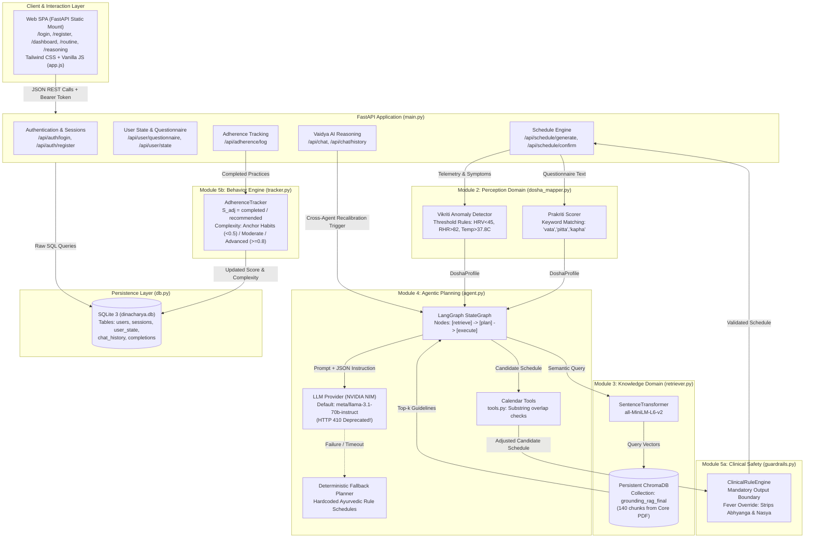
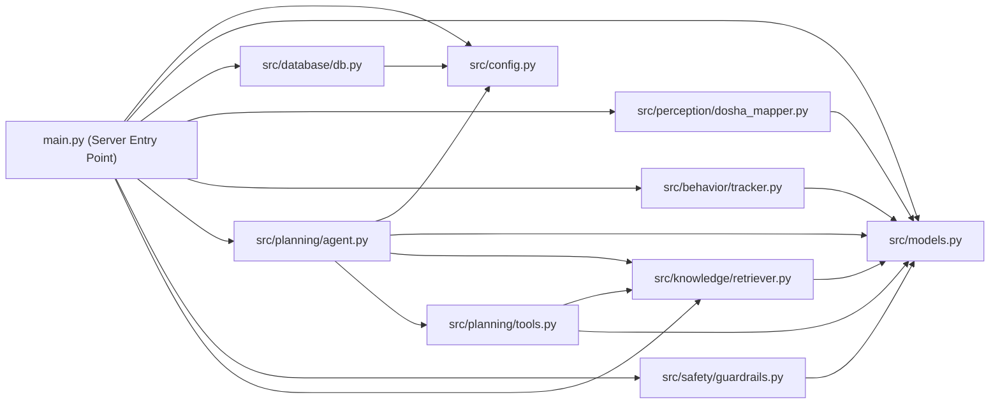
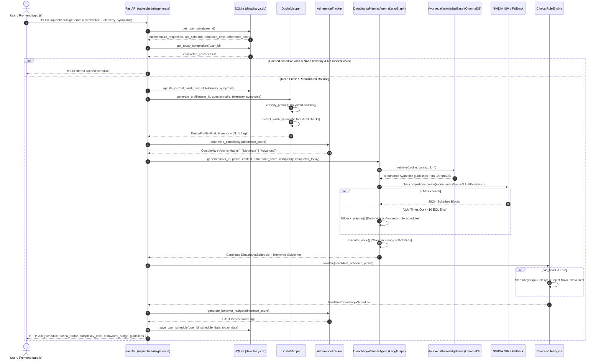
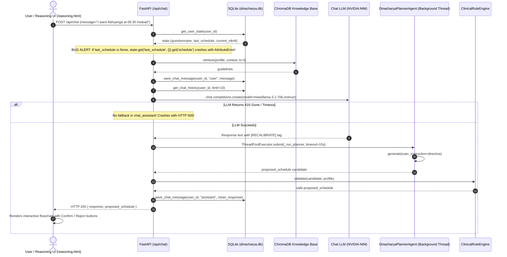
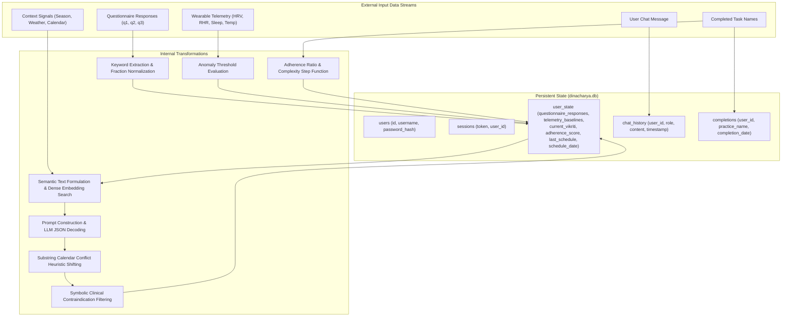

# AI DINCHARYA: COMPLETE CODEBASE FORENSIC AUDIT
## Document 02: Architecture and Dependency Map

**Audit Date:** October 13, 2026  
**Auditor:** Forensic Engineering Audit Agent (DeepMind Antigravity)  
**Repository Branch Inspected:** `Siddharth` (HEAD: `9311925`)  

---

### 1. Architectural Overview: Intended vs. Actual Implementation

The AI Dincharya capstone report (`Dinacharya_Full_Report.pdf`, Chapter 6) describes a sophisticated **Neuro-Symbolic Hybrid Architecture** comprising six interconnected pipelines:
1. Multimodal Ingestion Layer (Questionnaires, passive wearable BLE sync, weather APIs, calendar providers).
2. Dosha Mapping Pipeline (Supervised Prakriti ML classifier + Unsupervised Isolation Forest for Vikriti deviations).
3. Retrieval-Augmented Generation (RAG) Knowledge Retrieval (Vector embeddings grounded in canonical Ayurvedic Samhitas).
4. Agentic Planning Module (LangGraph multi-agent Plan-and-Execute with calendar constraint satisfaction).
5. Deterministic Safety Guardrail Engine (Symbolic contraindication filter with hard clinical boundaries).
6. Closed-Loop Behavioral Adaptation & EAST Nudging (Habit adherence tracking and rolling complexity scaling).

#### Ground Truth Architectural Reality:
The current active implementation on branch `Siddharth` is a **monolithic Python FastAPI application** serving raw HTML/JS assets, directly communicating with a local SQLite database, a local persistent ChromaDB vector store, and a hosted OpenAI-compatible LLM endpoint (NVIDIA NIM).

While the foundational interfaces and concepts exist, the implementation reveals significant divergence between documented designs and actual code:

| Pipeline Domain | Intended Architecture (Capstone Report) | Actual Implemented Architecture (Active Codebase) | Discrepancy Severity |
|---|---|---|---|
| **API & Server** | Decoupled microservices or modular API layer | Monolithic FastAPI app in `main.py` directly mounting raw static HTML files | Moderate |
| **Prakriti Mapping** | Multilayer Perceptron (MLP) or Random Forest trained on 24-item bilingual clinical questionnaire | Static keyword frequency counter in `DoshaMapper.classify_prakriti` over 3 form fields | High |
| **Vikriti Detection** | 7-day rolling statistics analyzed via Isolation Forest anomaly detection | 4 hardcoded `if/else` threshold checks on single-point dictionary values | High |
| **Knowledge RAG** | Canonical Sanskrit & English Ayurvedic texts with metadata filtering and citation attribution | Single 20.9MB PDF (`Core_Dinacharya_Grounding.pdf`) chunked and queried via ChromaDB with `all-MiniLM-L6-v2` | Low (Genuinely functional) |
| **Agent Planning** | Multi-agent autonomous LangGraph orchestration with tool-calling loops and calendar negotiation | Fixed 3-node sequential LangGraph pipeline (`retrieve` -> `plan` -> `execute`), calling an LLM for single-shot JSON generation, with rigid substring replacement for calendar events | Moderate |
| **Safety Engine** | Comprehensive symbolic Contraindication Registry covering all classical Ayurvedic clinical exclusions | Single `if has_fever:` conditional check stripping `abhyanga` and `nasya` and replacing them with hardcoded strings | High |
| **Behavior Adaptation** | Longitudinal habit tracking, decay modeling, contextual push notifications via FCM/APNS | Single formula ($S_{adj} = \text{completed}/\text{recommended}$) updating an integer field; nudges are static string dicts | Moderate |
| **Frontend UI** | Cross-platform Flutter mobile application + modern web companion | Multi-page static HTML/Tailwind templates driven by vanilla JavaScript (`app.js`) using session storage | Moderate (Active app works, but diverges from React/Flutter branches) |

---

### 2. High-Level System Architecture Diagram



---

### 3. Subsystem Dependency Relationships



#### Observations on Dependency Structure:
- **`src.models` is the canonical domain model**: All subsystems import from `src.models`, making it the cleanest and most stable contract in the codebase.
- **`src.database.db` executes `init_db()` upon import**: Side-effecting database initialization occurs at module import time (line 233 of `src/database/db.py`).
- **`src.knowledge.retriever` initializes embeddings and vector store upon import/instantiation**: Instantiating `AyurvedaKnowledgeBase` immediately loads PyTorch weights into memory and reads the ChromaDB directory.
- **Monolithic coupling in `main.py`**: `main.py` directly orchestrates and imports every subsystem. There is no dependency injection framework or application container; all dependencies are instantiated in-line inside route functions.

---

### 4. Major Workflow Execution Diagrams

#### 4.1 Schedule Generation & Daily Adaptation Workflow



---

#### 4.2 Vaidya AI Conversational Recalibration Workflow



---

### 5. Data Flow Diagram



---

### 6. Team Branch Divergence Analysis

A critical forensic finding is that **four distinct architectural visions exist concurrently across different Git branches** in the repository:

```
Commit Graph:
* 9311925 (HEAD -> Siddharth) Adding test flows
* a7ce180 Swapped router from puter to nvidia nim and introduced time cut offs
|
|   * cc1cbf3 (origin/main) Merge PR #2 from Swapnil
|  /|
| / * 6dfe884 (origin/Swapnil) Add rotating Gemini and OpenRouter providers
| |/
* | b378585 Merge PR #1 from Siddharth
|/
* 6859c7f Initial project import

Remote Divergences:
- origin/Kirr: Full React + Vite + TypeScript frontend in src/ (App.tsx, Dashboards, Drawers, Modals)
- origin/shreyansh: Complete monorepo re-architecture into backend/, frontend/, mobile_app/ (Flutter), docs/
```

#### Detailed Branch Comparison:

1. **`Siddharth` (Current Checked Out Working Tree)**:
   - Root-level monolithic layout.
   - FastAPI server in `main.py` serving static HTML/JS files in `src/static/`.
   - Single LLM provider via NVIDIA NIM (`meta/llama-3.1-70b-instruct`).
   - Dynamic port finding on startup.

2. **`main` / `Swapnil`**:
   - Introduces `src/llm_client.py` (`RotatingLLMClient`).
   - Cycles through multiple Gemini API keys and OpenRouter fallbacks when rate-limited.
   - Still uses monolithic root-level structure.

3. **`Kirr`**:
   - Developed a modern Single Page Application (SPA) in React 18, Vite, TypeScript, Lucide Icons, and Tailwind.
   - Contains components for `DoshaModal`, `HealthModal`, `NotificationsDrawer`, `SettingsDrawer`, `TaskModal`.
   - Not merged into `main` or `Siddharth`.

4. **`shreyansh`**:
   - Completely restructured the repository into:
     - `backend/` (FastAPI backend with expanded analytics and notification modules).
     - `frontend/` (Vite/React frontend based on Kirr's work).
     - `mobile_app/` (Flutter/Dart mobile application with telemetry sync and Vaidya chat).
     - `docs/` (Extensive diagnostic and setup guides).
   - Not merged into `main` or `Siddharth`.

**Implication for Architectural Restart**: The team has already recognized the limitations of the monolithic prototype on `Siddharth` and attempted independently to build a modular monorepo (`shreyansh`), a React frontend (`Kirr`), and multi-provider LLM failover (`Swapnil`). However, these efforts occurred in uncoordinated branches without unified architectural governance.

---

### 7. Post-Implementation Architectural Topology & Integration Boundaries (October 14, 2026)

Following targeted repairs, the active architectural topology on branch `Siddharth` incorporates a centralized LLM Gateway, a high-performance routine caching path, and a persistent notification outbox.

```mermaid
graph TB
    subgraph ClientLayer ["Client & Interaction Layer (src/static/)"]
        WebSPA["Web SPA (FastAPI Static Mount)<br/>Tailwind CSS + Vanilla JS (app.js)<br/>Session Storage Cache Sync"]
    end

    subgraph APILayer ["FastAPI Monolith (main.py - 821 lines)"]
        AuthRouter["Auth & Sessions<br/>/api/auth/login, /api/auth/register"]
        UserRouter["User State & Questionnaire<br/>/api/user/questionnaire, /api/user/state"]
        FastSched["Fast Routine Read<br/>GET /api/schedule/current (3.09ms)"]
        GenSched["Schedule Generation & Cache<br/>POST /api/schedule/generate (3.33ms cached)"]
        AdaptRouter["Circumstance Adaptation<br/>POST /api/agent/adapt"]
        ChatRouter["Conversational Reasoning<br/>POST /api/chat (NLP Acceptance Commit)"]
        NotifyRouter["Notification Outbox<br/>GET /api/notifications, POST /read"]
        InsightRouter["Flowchart Insights<br/>GET /api/insights"]
    end

    subgraph ResilienceLayer ["Core Resilience Infrastructure (src/llm_gateway.py)"]
        LLMGateway["Centralized LLMGateway<br/>- Primary: Nemotron 3.5 Lightning 30B<br/>- Secondary Fallback: GPT-OSS-20B<br/>- Token Budgeting (max_tokens=4096)<br/>- Markdown Fence & Regex JSON Stripping<br/>- Multi-Step Tool Loop Execution"]
    end

    subgraph PlanningDomain ["Module 4: Planning & Agent Domain"]
        LangGraph["DinacharyaPlannerAgent<br/>3-Node Sequential Graph<br/>Circumstance Adaptation Engine"]
        ToolDispatcher["Planner Tools & Dispatcher (src/planning/tools.py)<br/>rag_ayurveda_search, check_clinical_safety,<br/>detect_calendar_conflicts, update_schedule_activity"]
    end

    subgraph SafetyDomain ["Module 5: Safety Guardrail Boundary (src/safety/)"]
        ClinicalSafety["ClinicalRuleEngine<br/>Enforced on Generation, Chat Adaptation & Confirmation"]
    end

    subgraph PersistenceLayer ["Persistent Storage Layer"]
        ChromaStore[("ChromaDB Vector Store<br/>Core_Dinacharya_Grounding.pdf<br/>140 embeddings (all-MiniLM-L6-v2)")]
        SQLiteDB[("Canonical SQLite Database (dinacharya.db)<br/>- users & sessions<br/>- user_state (canonical routines)<br/>- chat_history<br/>- notifications (persistent outbox)")]
    end

    %% Interactions
    WebSPA --> FastSched
    WebSPA --> GenSched
    WebSPA --> ChatRouter
    WebSPA --> NotifyRouter

    FastSched -->|Direct DB Read (3.09ms)| SQLiteDB
    GenSched -->|Cache Hit (3.33ms)| SQLiteDB
    GenSched -->|Cache Miss (Initial 28s)| LangGraph

    LangGraph --> ToolDispatcher
    ToolDispatcher --> ChromaStore
    LangGraph --> LLMGateway
    LangGraph --> ClinicalSafety
    ClinicalSafety --> SQLiteDB

    ChatRouter --> LLMGateway
    ChatRouter -->|NLP Acceptance Commit| ClinicalSafety
    ClinicalSafety --> SQLiteDB
    ChatRouter -->|Trigger Event| SQLiteDB

    InsightRouter --> LLMGateway
    NotifyRouter --> SQLiteDB
```

#### 7.1 Key Architectural Integration Boundary Changes:
1. **Decoupled LLM Call Execution via `LLMGateway`:** All LLM invocations in `main.py` (`/api/insights`, `/api/chat`) and `src/planning/agent.py` route through `LLMGateway`, eliminating direct unhandled OpenAI SDK calls and insulating routes from provider timeouts and malformed JSON.
2. **Bypassed Generation Loop on Routine Retrieval:** The architectural data flow was restructured. `GET /api/schedule/current` reads directly from SQLite `user_state` table in **3.09 ms**, completely bypassing LangGraph, ChromaDB, and NVIDIA NIM for established daily routines.
3. **Conversational Adaptation Commitment Pipeline:** When the user utters confirmation in chat, the pipeline bypasses conversational free text generation, directly executes Pydantic schedule validation and `ClinicalRuleEngine.evaluate_safety`, updates the canonical `user_state.schedule` JSON payload, and writes an event to the `notifications` outbox.
4. **Tool Calling Architectural Status:** Tools are formally structured as OpenAI schemas in `src/planning/tools.py` and dispatched through `execute_planner_tool`. The benchmark harness (`scripts/benchmark_models.py`) and `LLMGateway.execute_tool_loop` successfully exercise model-driven tool calling. However, the production `planner_node` and `/api/chat` routes have not yet connected these schemas to their prompt parameters, retaining hardcoded node-based execution.

