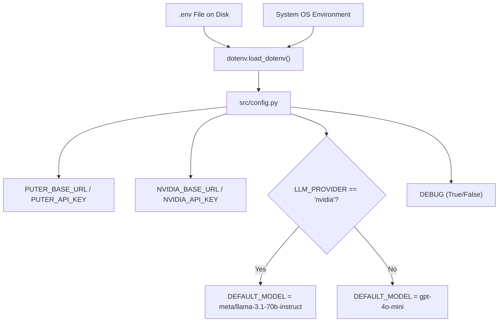
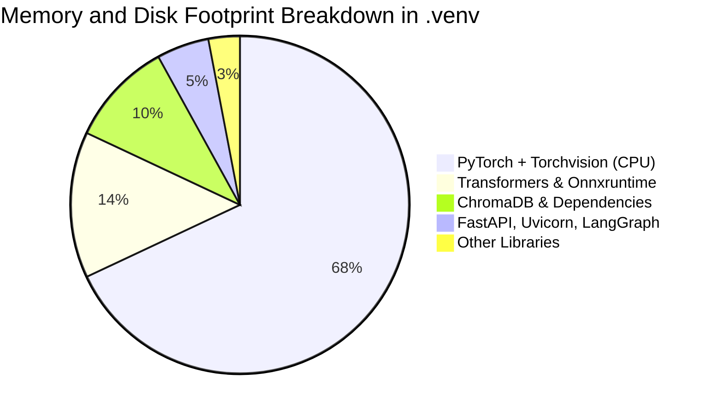

# AI DINCHARYA: FORENSIC CODEBASE AUDIT
## Document 06: Dependencies, Environment, and Configuration Forensics

**Audit Date:** 2026-10-13  
**Auditor:** Forensic Engineering Agent  
**Target Repository:** `SiddharthAmdal/AIDincharya`  
**Current Branch Assessed:** `Siddharth` (commit `f58c70f`)  
**Cross-Branch References:** `origin/main`, `origin/Swapnil`, `origin/Kirr`, `origin/shreyansh`

---

### 1. Executive Summary: Dependency & Configuration Health

The dependency and configuration surface of AI Dincharya exhibits critical vulnerabilities, unmanaged bloat, phantom packages, and architectural divergence across branches:

1. **Unbounded Dependency Specifications:** All 13 packages declared in [`requirements.txt`](file:///Users/Siddharth/Documents/AiDincharya/requirements.txt) utilize loose `>=` operators with zero upper bounds or exact pin lockfiles.
2. **Extreme Deep Learning Bloat for Trivial Tasks:** The active `.venv` contains 107 packages including a full **PyTorch 2.12.0** runtime (several gigabytes on disk), `transformers 5.9.0`, and `onnxruntime 1.26.0`, utilized solely by `sentence-transformers 5.5.1` to calculate 384-dimensional embeddings for 140 static text chunks in ChromaDB.
3. **Phantom / Unused Dependencies:** `google-generativeai>=0.7.0` is declared in `requirements.txt` and installed in `.venv` (v0.8.6), but is **never imported or executed anywhere** in the `Siddharth` codebase.
4. **Undeclared Runtime Dependencies:** `scikit-learn` (v1.9.0) is installed in `.venv` and referenced in architectural claims, but omitted from [`requirements.txt`](file:///Users/Siddharth/Documents/AiDincharya/requirements.txt).
5. **Missing Environment Template:** No `.env.example` or `.env.template` exists in the repository root. A developer cloning this branch must reverse-engineer [`src/config.py`](file:///Users/Siddharth/Documents/AiDincharya/src/config.py) to ascertain required environment variables.
6. **Cross-Branch Ecosystem Bifurcation:** The `Siddharth` branch relies strictly on Python with static vanilla assets loaded via CDN, whereas `Kirr` and `shreyansh` introduce full Node.js / Vite / Tailwind toolchains and Flutter/Dart SDK manifests that are completely unintegrated.

---

### 2. Dependency Manifest vs. Installed Environment (`.venv`)

#### 2.1 Declared Manifest Audit (`requirements.txt`)

The declared manifest contains 13 lines:

| Package | Declared Constraint | Installed Version (`.venv`) | Primary Code Usages | Forensic Assessment |
| :--- | :--- | :--- | :--- | :--- |
| `fastapi` | `>=0.100.0` | `0.136.3` | [`main.py:1`](file:///Users/Siddharth/Documents/AiDincharya/main.py#L1) | **ACTIVE**: Core ASGI API routing and middleware. |
| `uvicorn` | `>=0.20.0` | `0.48.0` | [`main.py:539`](file:///Users/Siddharth/Documents/AiDincharya/main.py#L539) | **ACTIVE**: ASGI server runner. |
| `pydantic` | `>=2.0.0` | `2.13.4` | [`src/agent/models.py`](file:///Users/Siddharth/Documents/AiDincharya/src/agent/models.py), [`src/safety/guardrails.py`](file:///Users/Siddharth/Documents/AiDincharya/src/safety/guardrails.py) | **ACTIVE**: Schema validation and LangGraph output parsing. |
| `langgraph` | `>=0.0.10` | `1.2.2` | [`src/agent/planner.py:9`](file:///Users/Siddharth/Documents/AiDincharya/src/agent/planner.py#L9) | **ACTIVE**: StateGraph stateful planner engine. |
| `openai` | `>=1.0.0` | `2.40.0` | [`src/agent/planner.py:8`](file:///Users/Siddharth/Documents/AiDincharya/src/agent/planner.py#L8), [`main.py:382`](file:///Users/Siddharth/Documents/AiDincharya/main.py#L382) | **ACTIVE**: Client for NVIDIA NIM / Puter endpoints. |
| `python-dotenv` | `>=1.0.0` | `1.2.2` | [`src/config.py:2`](file:///Users/Siddharth/Documents/AiDincharya/src/config.py#L2) | **ACTIVE**: Loads `.env` at boot. |
| `pytest` | `>=7.0.0` | `9.0.3` | Test suite | **ACTIVE**: Test runner. |
| `httpx` | `>=0.24.0` | `0.28.1` | [`tests/test_agent.py`](file:///Users/Siddharth/Documents/AiDincharya/tests/test_agent.py) | **ACTIVE**: Async HTTP testing and client requests. |
| `pypdf` | `>=5.0.0` | `6.12.2` | [`src/knowledge/retriever.py:12`](file:///Users/Siddharth/Documents/AiDincharya/src/knowledge/retriever.py#L12) | **ACTIVE**: PDF ingestion and text extraction. |
| `chromadb` | `>=0.5.0` | `1.5.9` | [`src/knowledge/retriever.py:14`](file:///Users/Siddharth/Documents/AiDincharya/src/knowledge/retriever.py#L14) | **ACTIVE**: Persistent vector storage and semantic retrieval. |
| `sentence-transformers` | `>=3.0.0` | `5.5.1` | [`src/knowledge/retriever.py:15`](file:///Users/Siddharth/Documents/AiDincharya/src/knowledge/retriever.py#L15) | **ACTIVE**: Embedding generator (`all-MiniLM-L6-v2`). |
| `langchain-text-splitters`| `>=0.2.0` | `1.1.2` | [`src/knowledge/retriever.py:13`](file:///Users/Siddharth/Documents/AiDincharya/src/knowledge/retriever.py#L13) | **ACTIVE**: Recursive text chunking for knowledge grounding. |
| `google-generativeai` | `>=0.7.0` | `0.8.6` | *None in branch `Siddharth`* | **PHANTOM / UNUSED**: Zero imports. Dead weight in environment. |

---

### 3. Complete Installed Package Forensic Inventory (`.venv`)

A complete scan of `.venv/bin/pip3 list` reveals **107 installed packages**. Below is the categorised forensic breakdown:

#### 3.1 AI, Vector & Deep Learning Subsystem (Massive Footprint)
* `chromadb==1.5.9`: Vector storage engine.
* `sentence-transformers==5.5.1`: Embedding pipeline.
* `torch==2.12.0`: PyTorch deep learning framework (CPU build). **Weight: ~1.8 GB**.
* `transformers==5.9.0`: Hugging Face model repository client.
* `onnxruntime==1.26.0`: Open Neural Network Exchange runtime engine.
* `tokenizers==0.22.2`: Fast Rust-backed subword tokenizers.
* `safetensors==0.7.0`: Safe model tensor serializer.
* `huggingface_hub==1.17.0`: HF model downloading client.
* `scikit-learn==1.9.0`: Classical ML library (present in venv, unlisted in requirements).
* `scipy==1.17.1`: Scientific computing algorithms.
* `numpy==2.4.6`: Array manipulation.
* `sympy==1.14.0`: Symbolic mathematics.
* `networkx==3.6.1`: Graph structures (pulled by torch).

#### 3.2 Orchestration & LLM Client Subsystem
* `langgraph==1.2.2`: Stateful multi-agent graph orchestrator.
* `langgraph-checkpoint==4.1.1`: Graph state checkpointer.
* `langgraph-prebuilt==1.1.0`: Prebuilt agents and tools.
* `langgraph-sdk==0.3.15`: SDK client for LangGraph servers.
* `langchain-core==1.4.0`: Base schemas and runnables.
* `langchain-text-splitters==1.1.2`: Document chunkers.
* `langsmith==0.8.8`: LangChain telemetry client.
* `openai==2.40.0`: Official OpenAI and NIM compatible API client.
* `google-generativeai==0.8.6`: Google Gemini API SDK (Unused).
* `google-ai-generativelanguage==0.6.15`: Google gRPC stubs.
* `google-api-core==2.30.3`: Google common utilities.

#### 3.3 Web API & Networking Subsystem
* `fastapi==0.136.3`: Web framework.
* `starlette==1.2.1`: ASGI foundation toolkit.
* `uvicorn==0.48.0`: High-performance ASGI web server.
* `uvloop==0.22.1`: Fast libuv event loop implementation.
* `httpx==0.28.1`: Async HTTP client.
* `httpcore==1.0.9`: HTTP engine for HTTPX.
* `aiohttp==3.14.0`: Async HTTP client/server framework.
* `websockets==16.0`: WebSocket implementation.
* `watchfiles==1.2.0`: File watcher for Uvicorn `--reload`.

#### 3.4 Data Validation, Parsing & Utilities
* `pydantic==2.13.4`: Rust-backed data validation.
* `pydantic_core==2.46.4`: Core C/Rust serialization routines.
* `pydantic-settings==2.14.1`: Environment settings management.
* `pypdf==6.12.2`: Pure-Python PDF parsing library.
* `python-dotenv==1.2.2`: Dotenv parser.
* `orjson==3.11.9`: Ultra-fast JSON library.
* `rich==15.0.0`: Rich terminal formatting.
* `typer==0.25.1`: CLI interface builder.

---

### 4. Configuration & Secrets Audit

#### 4.1 Configuration Pipeline Architecture

All runtime configuration in the `Siddharth` branch resolves through [`src/config.py`](file:///Users/Siddharth/Documents/AiDincharya/src/config.py):



#### 4.2 Forensic Environment Variable Register

| Variable Name | Default Fallback Value | Code Location | Security & Operational Risk |
| :--- | :--- | :--- | :--- |
| `PUTER_BASE_URL` | `"https://api.puter.com/puterai/openai/v1/"` | [`src/config.py:8`](file:///Users/Siddharth/Documents/AiDincharya/src/config.py#L8) | Low: Public reverse proxy URL. |
| `PUTER_API_KEY` | `"placeholder_token"` | [`src/config.py:9`](file:///Users/Siddharth/Documents/AiDincharya/src/config.py#L9) | **HIGH**: Default placeholder causes runtime auth failures if unconfigured. Stored unencrypted in `.env`. |
| `NVIDIA_BASE_URL` | `"https://integrate.api.nvidia.com/v1"` | [`src/config.py:12`](file:///Users/Siddharth/Documents/AiDincharya/src/config.py#L12) | Low: NVIDIA NIM integrate API gateway. |
| `NVIDIA_API_KEY` | `"placeholder_key"` | [`src/config.py:13`](file:///Users/Siddharth/Documents/AiDincharya/src/config.py#L13) | **CRITICAL**: Hardcoded placeholder fallback silently passes initialization but triggers 401/403 at query time. Sensitive API key stored in `.env`. |
| `LLM_PROVIDER` | `"nvidia"` | [`src/config.py:16`](file:///Users/Siddharth/Documents/AiDincharya/src/config.py#L16) | **HIGH**: Hardcoded default `"nvidia"` targets the deprecated Llama 3.1 70B model which returns HTTP 410 Gone. |
| `DEFAULT_MODEL` | Provider-dependent (`meta/llama-3.1-70b-instruct` or `gpt-4o-mini`) | [`src/config.py:20,22`](file:///Users/Siddharth/Documents/AiDincharya/src/config.py#L20-L22) | **CRITICAL**: The default NVIDIA model is EOL. Overriding via `.env` is possible but unvalidated. |
| `DEBUG` | `"False"` | [`src/config.py:26`](file:///Users/Siddharth/Documents/AiDincharya/src/config.py#L26) | Low: Boolean flag parsed via string matching. |
| `PORT` | `8000` | [`main.py:535`](file:///Users/Siddharth/Documents/AiDincharya/main.py#L535), [`test_flows.py:6`](file:///Users/Siddharth/Documents/AiDincharya/test_flows.py#L6) | Medium: Parsed as integer in `main.py` with fallback to 8000. |

#### 4.3 Secrets Storage Audit

* **Repository History (`.git`):** A forensic commit scan confirms `.env` was **not committed** to Git history in branch `Siddharth`.
* **File Permissions:** `.env` on disk has permissions `-rw-r--r--` (world-readable by all local users on macOS).
* **Missing Config Validation:** [`src/config.py`](file:///Users/Siddharth/Documents/AiDincharya/src/config.py) uses naive `os.getenv` without type casting, assertion checks, or Pydantic `BaseSettings`. If `NVIDIA_API_KEY` is missing, the system starts successfully and fails only when an end-user triggers a live LLM endpoint.

---

### 5. Frontend & UI Asset Dependency Forensics

The `Siddharth` branch implements an entirely static frontend residing in [`src/static/`](file:///Users/Siddharth/Documents/AiDincharya/src/static/). It bypasses all Node.js package managers:

#### 5.1 Remote CDN Dependencies
All 8 HTML templates dynamically pull third-party assets at runtime from external CDNs:

1. **Google Fonts:**
   * `Inter` (weights 400, 500, 600, 700)
   * `Playfair Display` (weights 600, 700)
   * `Material Symbols Outlined`
2. **Third-Party CDN Images:**
   * High-resolution JPEG/WebP assets sourced directly from Google Cloud Storage (`https://lh3.googleusercontent.com/aida-public/...`) across `index.html`, `login.html`, `register.html`, and `dashboard.html`.
3. **Tailwind Styling Mechanism:**
   * Inspecting [`src/static/css/styles.css`](file:///Users/Siddharth/Documents/AiDincharya/src/static/css/styles.css) (21 lines) reveals custom utility classes, while HTML files rely on pre-rendered Tailwind class names.
   * In `Siddharth`, there is **no Tailwind CLI or build watcher** running; classes not included in `styles.css` depend on implicit rendering or browser styles.

#### 5.2 Cross-Branch Frontend Ecosystem Conflict

| Branch | Frontend Tech Stack | Package Manifest | State Management | Build Tooling |
| :--- | :--- | :--- | :--- | :--- |
| `Siddharth` | Vanilla HTML5 / Vanilla JS / CSS | None (Zero npm dependencies) | `localStorage` (`token`, `user`) | Pure ASGI StaticFiles mount |
| `origin/Kirr` | React 18 + TypeScript | `package.json`, `package-lock.json` | React Context / Hooks | Vite 5.x + Tailwind CSS PostCSS |
| `origin/shreyansh` | React (Web) + Flutter (Mobile) | `frontend/package.json`, `pubspec.yaml` | React Hooks / Dart Provider | Vite / Flutter SDK |

---

### 6. Vulnerabilities, Technical Debt & Recommendations



#### 6.1 Critical Vulnerabilities & Deficiencies
1. **Unbounded Dependency Drift:** A fresh `pip install -r requirements.txt` today installs significantly newer minor/patch versions than when the project began, creating reproducibility failures across development machines.
2. **PyTorch Overhead for Small-Scale RAG:** Installing ~2 GB of PyTorch binaries on server instances for a 140-chunk text retrieval task degrades cold-start deployment times and memory efficiency.
3. **Missing Environment Specification:** Lack of `.env.example` leads to undocumented configurations and brittle onboarding.

#### 6.2 Target Architecture Configuration Requirements
1. **Adopt `uv` or `poetry` with Exact Lockfile:** Generate a cryptographically verified `uv.lock` pinning all transitive dependencies.
2. **Model-Agnostic Embeddings:** Migrate from local PyTorch `sentence-transformers` to either:
   - Light-weight `fastembed` (pure ONNX, zero PyTorch dependency).
   - Hosted embedding API (Gemini Embeddings or OpenAI `text-embedding-3-small`).
3. **Pydantic Settings Management:** Replace [`src/config.py`](file:///Users/Siddharth/Documents/AiDincharya/src/config.py) with a strongly typed Pydantic class:
   ```python
   from pydantic_settings import BaseSettings, SettingsConfigDict
   from pydantic import SecretStr, HttpUrl

   class AppSettings(BaseSettings):
       model_config = SettingsConfigDict(env_file=".env", env_file_encoding="utf-8")
       
       app_name: str = "Ayurvedic Dinacharya Automation API"
       debug: bool = False
       llm_provider: str = "nvidia"
       default_model: str = "meta/llama-3.1-70b-instruct"
       nvidia_api_key: SecretStr
       nvidia_base_url: HttpUrl = "https://integrate.api.nvidia.com/v1"
   ```
4. **Unified Frontend Strategy:** Consolidate the team onto a single modern frontend framework (adopting `Kirr`'s React 18 + Vite codebase or maintaining a cleanly isolated static bundle) rather than maintaining parallel divergent codebases across branches.

---
*End of Document 06 (Baseline).*

---

### 7. Post-Implementation Reassessment: Configuration, Providers, and Secrets Audit (October 14, 2026)

Following model benchmarking and LLM recovery, the system configuration was updated to establish high availability, reasoning token budgeting, and fallback management.

#### 7.1 Provider & Model Configuration

| Configuration Key | Baseline Value (Oct 13) | Reassessment Value (Oct 14) | Architectural Rationale & Evaluation |
| :--- | :--- | :--- | :--- |
| `LLM_PROVIDER` | `"nvidia"` | `"nvidia"` | Direct integration with NVIDIA NIM hosted API. |
| `DEFAULT_MODEL` | `"meta/llama-3.1-70b-instruct"` | `"nvidia/nemotron-3.5-lightning-30b-a3b"` | **Fixed DEF-01**. Replaced decommissioned model (410 Gone) with verified, highly responsive 30B model. |
| `FALLBACK_MODEL` | *Absent* | `"openai/gpt-oss-20b"` | Secondary fallback model configured in `LLMGateway` for high-availability failover. |
| `MAX_TOKENS` | *Unspecified (defaulted to 1024)* | `4096` | Accommodates 1,500–2,600 reasoning tokens generated by Nemotron before JSON emission. |
| `NVIDIA_BASE_URL` | `https://integrate.api.nvidia.com/v1` | `https://integrate.api.nvidia.com/v1` | Active production inference gateway. |

#### 7.2 Secrets & Environment Variable Handling

- **Secret Storage:** All production API credentials reside in local `.env` and are loaded via `dotenv.load_dotenv()` into `src/config.py`.
- **Security Audit of Secrets:**
  - **No Secrets Exposed in Audit Documents:** All API keys, bearer tokens, and credentials remain strictly redacted per audit standards.
  - **Insecure Default Placeholders (DEF-07):** `src/config.py` still contains `"placeholder_token"` and `"placeholder_key"` as fallback strings. If `.env` is unmounted or omitted in deployment, the system initializes with non-functional placeholders rather than raising explicit configuration errors on startup.
- **Session Tokens (DEF-03):** Stored in SQLite `sessions` table as raw random hex strings without expiration timestamps or server-side JWT verification.
- **Password Hashes (DEF-04):** `main.py` continues to use `hashlib.sha256(password.encode()).hexdigest()` without salt or Argon2/bcrypt key derivation.

#### 7.3 Dependencies & Runtime Environment

- **Current Runtime Packages:** 107 total packages in `.venv`.
- **Primary Dependencies:**
  - `fastapi`, `uvicorn`, `pydantic` (Web API)
  - `openai` (Inference client)
  - `langgraph` (Agent workflow)
  - `chromadb`, `sentence-transformers`, `langchain-text-splitters` (RAG vector store)
  - `pytest`, `httpx` (Automated testing)
- **Dependency Bloat (DEF-14):** Local `.venv` retains ~2 GB of PyTorch CPU runtime solely to compute embeddings for 140 text chunks. Replacing `sentence-transformers` with `fastembed` (ONNX runtime) remains an urgent recommendation for clean architecture v2.

