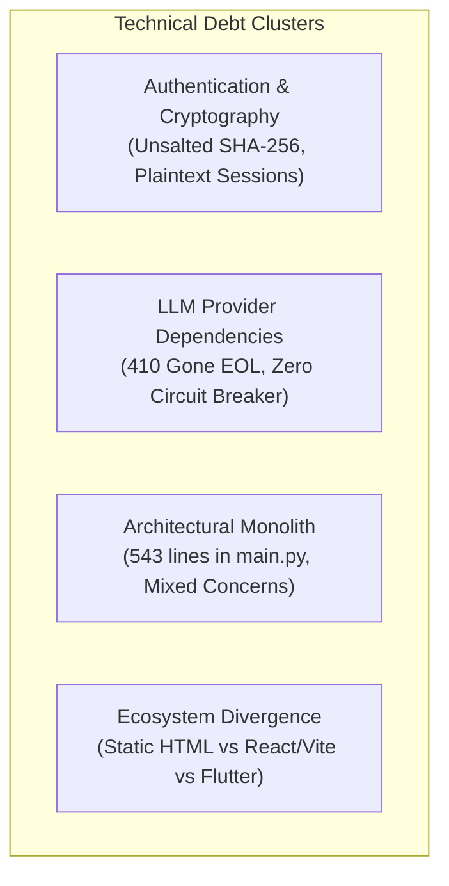

# AI DINCHARYA: FORENSIC CODEBASE AUDIT
## Document 07: Defects, Security Vulnerabilities, and Technical Debt Register

**Audit Date:** 2026-10-13  
**Auditor:** Forensic Engineering Agent  
**Target Repository:** `SiddharthAmdal/AIDincharya`  
**Current Branch Assessed:** `Siddharth` (commit `f58c70f`)  
**Assessment Standards:** OWASP Top 10 API Security, CWE/SANS Top 25, Clean Architecture Guidelines

---

### 1. Forensic Defect & Vulnerability Matrix

| Defect ID | Severity | Category | File Location | Symbol / Line | Impact Summary |
| :--- | :--- | :--- | :--- | :--- | :--- |
| **DEF-01** | **CRITICAL** | External EOL / Outage | [`src/config.py`](file:///Users/Siddharth/Documents/AiDincharya/src/config.py#L20) | `DEFAULT_MODEL` (L20) | NVIDIA NIM endpoint decommissioned (HTTP 410 Gone); breaks live LLM generation. |
| **DEF-02** | **CRITICAL** | Null Pointer / Crash | [`main.py`](file:///Users/Siddharth/Documents/AiDincharya/main.py#L328) | `chat_assistant` (L328) | `AttributeError: 'NoneType' object has no attribute 'get'` crashes `/api/chat` for new users. |
| **DEF-03** | **CRITICAL** | Broken Authentication | [`src/database/db.py`](file:///Users/Siddharth/Documents/AiDincharya/src/database/db.py#L31-L36) | `sessions` table (L31-36, 114-121) | Plaintext bearer tokens stored without expiry timestamps; cannot be invalidated; permanent access. |
| **DEF-04** | **CRITICAL** | Cryptographic Failure | [`main.py`](file:///Users/Siddharth/Documents/AiDincharya/main.py#L93) | `register` / `login` (L93, 102) | Unsalted SHA-256 password hashing (CWE-328/CWE-759); vulnerable to fast dictionary and rainbow table attacks. |
| **DEF-05** | **HIGH** | Reliability / Resilience | [`main.py`](file:///Users/Siddharth/Documents/AiDincharya/main.py#L307) | `get_dynamic_insights` (L307), `chat_assistant` (L392) | Zero fallback handling around auxiliary LLM calls; crashes user dashboard and chat on API failure. |
| **DEF-06** | **HIGH** | Security Misconfig | [`main.py`](file:///Users/Siddharth/Documents/AiDincharya/main.py#L34-L40) | CORS Middleware (L34-40) | `allow_origins=["*"]` combined with `allow_credentials=True` violates browser security standards. |
| **DEF-07** | **HIGH** | Insecure Defaults | [`src/config.py`](file:///Users/Siddharth/Documents/AiDincharya/src/config.py#L9) | Config fallbacks (L9, 13) | `"placeholder_key"` / `"placeholder_token"` silently pass boot checks and fail late at runtime. |
| **DEF-08** | **HIGH** | Architecture Smell | [`main.py`](file:///Users/Siddharth/Documents/AiDincharya/main.py#L1-L543) | Monolith Module (L1-543) | 543-line file mixing auth, database migrations, LLM routing, HTML streaming, and business logic. |
| **DEF-09** | **MEDIUM** | Dead Code / Broken Route | [`main.py`](file:///Users/Siddharth/Documents/AiDincharya/main.py#L515) | `remote_log` (L515-518) | Unmounted endpoint handler; missing `@app.post(...)` decorator; client remote logging fails. |
| **DEF-10** | **MEDIUM** | Broken Diagnostic Test | [`test_rag_and_agent.py`](file:///Users/Siddharth/Documents/AiDincharya/test_rag_and_agent.py#L57) | `diagnostic` (L57) | Treats dictionary return as Pydantic model (`schedule.morning_block`), raising `AttributeError`. |
| **DEF-11** | **MEDIUM** | Dead Code Logic | [`src/safety/guardrails.py`](file:///Users/Siddharth/Documents/AiDincharya/src/safety/guardrails.py#L95) | `_filter_block` (L95) | Conditional `block == cleaned_block` is mathematically impossible when `replaced == True`. |
| **DEF-12** | **MEDIUM** | Algorithmic Fragility | [`src/perception/dosha_mapper.py`](file:///Users/Siddharth/Documents/AiDincharya/src/perception/dosha_mapper.py#L28-L33) | `classify_prakriti` (L28-33) | Naive substring matching creates false positives (e.g. "not cold", "fast food", "light-headed"). |
| **DEF-13** | **MEDIUM** | Logic Drift | [`src/behavior/tracker.py`](file:///Users/Siddharth/Documents/AiDincharya/src/behavior/tracker.py#L12-L28) | `update_score` (L12-28) | Unbounded adherence scoring lacks sliding window decay or temporal weighting. |
| **DEF-14** | **LOW** | System Bloat | `.venv` / `requirements.txt` | Environment Footprint | 2GB PyTorch CPU binaries installed solely for 140 static semantic chunk embeddings. |
| **DEF-15** | **LOW** | CDN Fragility | [`src/static/*.html`](file:///Users/Siddharth/Documents/AiDincharya/src/static/) | Remote Asset Links | Unpinned Google Storage image assets and Google Fonts degrade offline local testing. |
| **DEF-16** | **LOW** | Team Divergence | Git Branches | `origin/main`, `Swapnil`, `Kirr`, `shreyansh` | 4 incompatible implementations developed concurrently without Git merge discipline. |

---

### 2. Deep Dive: Critical Severity Defects

#### DEF-01: Live LLM Provider Deprecation (HTTP 410 Gone)
* **Location:** [`src/config.py:20`](file:///Users/Siddharth/Documents/AiDincharya/src/config.py#L20)
* **Code Trace:**
  ```python
  if LLM_PROVIDER == "nvidia":
      DEFAULT_MODEL = os.getenv("DEFAULT_MODEL", "meta/llama-3.1-70b-instruct")
  ```
* **Root Cause:** NVIDIA NIM retired `meta/llama-3.1-70b-instruct` on **2026-08-26T09:00:00Z**. API requests to `https://integrate.api.nvidia.com/v1/chat/completions` return:
  ```json
  {"detail": "Model meta/llama-3.1-70b-instruct has reached End-Of-Life as of 2026-08-26T09:00:00Z and is no longer available. (status 410)"}
  ```
* **Runtime Behavior:** Routine generation at `/api/schedule/generate` does not immediately fail only because [`DinacharyaPlannerAgent._fallback_planner`](file:///Users/Siddharth/Documents/AiDincharya/src/agent/planner.py#L131) catches the exception and outputs hardcoded fallback blocks. However, conversational reasoning (`POST /api/chat`) and dynamic node visualization (`GET /api/insights`) lack this fallback and crash with HTTP 500.
* **Remediation:** Update model identifier to an active provider model (e.g. `meta/llama-3.3-70b-instruct` or Google Gemini 1.5/2.0 Flash) and implement uniform provider failover across all agent invocations.

---

#### DEF-02: Unhandled NoneType in Chat Endpoint
* **Location:** [`main.py:328`](file:///Users/Siddharth/Documents/AiDincharya/main.py#L328)
* **Code Trace:**
  ```python
  # main.py line 326-328
  state = db.get_user_state(user_id)
  questionnaire = state.get("questionnaire_responses", {})
  current_routine = state.get("last_schedule", {}).get("schedule", {})
  ```
  ```python
  # src/database/db.py line 158
  "last_schedule": json.loads(row["last_schedule"] or 'null'),
  ```
* **Root Cause:** When a user registers, `row["last_schedule"]` is SQL `NULL`. In `db.py:158`, `json.loads('null')` parses to Python `None`. When `state.get("last_schedule", {})` executes, the key `"last_schedule"` **exists** in the dict with value `None`, so `.get()` returns `None` (bypassing the `{}` default). The subsequent `.get("schedule", {})` call executes on `None`, throwing:
  ```text
  AttributeError: 'NoneType' object has no attribute 'get'
  ```
* **Reproduction:**
  1. Register a new user: `POST /api/auth/register`
  2. Send a chat query: `POST /api/chat` with `{"message": "Hello"}`
  3. Response: `HTTP 500 Internal Server Error: 'NoneType' object has no attribute 'get'`
* **Remediation:**
  ```python
  last_sched = state.get("last_schedule") or {}
  current_routine = last_sched.get("schedule", {})
  ```

---

#### DEF-03: Plaintext Session Tokens Without Expiry or Invalidation
* **Location:** [`src/database/db.py:31-36, 114-121`](file:///Users/Siddharth/Documents/AiDincharya/src/database/db.py#L31-L36)
* **Code Trace:**
  ```python
  def create_session(user_id):
      token = secrets.token_urlsafe(32)
      conn = get_db_connection()
      c = conn.cursor()
      c.execute('INSERT INTO sessions (token, user_id) VALUES (?, ?)', (token, user_id))
      conn.commit()
      conn.close()
      return token
  ```
* **Root Cause:** 
  1. The `sessions` table contains only `token`, `user_id`, and `created_at`. There is no `expires_at` column.
  2. Tokens are stored in plaintext. If `dinacharya.db` is compromised or read, an attacker has immediate access to all 58 active sessions.
  3. No logout or token revocation API exists. Calling `logout()` in `app.js` merely drops the key from client `localStorage`. The server session remains permanently valid.
* **Remediation:**
  - Transition to signed, short-lived JWT tokens or hashed session IDs with explicit `expires_at` checks and a database revocation blacklist.

---

#### DEF-04: Unsalted SHA-256 Password Hashing
* **Location:** [`main.py:93, 102`](file:///Users/Siddharth/Documents/AiDincharya/main.py#L93)
* **Code Trace:**
  ```python
  pwd_hash = hashlib.sha256(req.password.encode()).hexdigest()
  ```
* **Root Cause:** Cryptographically broken password storage practice violating CWE-328 / CWE-759. Fast hash functions like SHA-256 without per-user random salt enable attackers to execute billions of guesses per second using GPUs or precomputed rainbow tables.
* **Remediation:** Replace with `passlib` / `argon2-cffi` or `bcrypt` with appropriate work factor:
  ```python
  import bcrypt
  hashed = bcrypt.hashpw(password.encode('utf-8'), bcrypt.gensalt())
  ```

---

### 3. High Severity Defects

#### DEF-05: Missing Error Interception in Auxiliary LLM Endpoints
* **Location:** [`main.py:307-310`](file:///Users/Siddharth/Documents/AiDincharya/main.py#L307-L310) (`/api/insights`) and [`main.py:392-396`](file:///Users/Siddharth/Documents/AiDincharya/main.py#L392-L396) (`/api/chat`)
* **Impact:** Unlike the main schedule generation workflow, these endpoints directly invoke `planner.openai_client.chat.completions.create` without catching external provider errors. Any rate limit (429), quota exhaustion (403), or provider deprecation (410) bubbles up to the root FastAPI handler, causing 500 errors and client UI degradation.
* **Remediation:** Wrap all LLM completions in a unified client with structured fallback responses.

#### DEF-06: Permissive Insecure CORS Configuration
* **Location:** [`main.py:34-40`](file:///Users/Siddharth/Documents/AiDincharya/main.py#L34-L40)
* **Code Trace:**
  ```python
  app.add_middleware(
      CORSMiddleware,
      allow_origins=["*"],
      allow_credentials=True,
      allow_methods=["*"],
      allow_headers=["*"],
  )
  ```
* **Security Risk:** Modern browsers reject responses where `Access-Control-Allow-Origin: *` is combined with `Access-Control-Allow-Credentials: true`. In production deployment, this exposes the API to Cross-Site Request Forgery (CSRF) if cookie-based sessions are introduced.
* **Remediation:** Explicitly specify allowed origin domains via environment configuration.

#### DEF-07: Hardcoded Insecure Fallback Secrets
* **Location:** [`src/config.py:9, 13`](file:///Users/Siddharth/Documents/AiDincharya/src/config.py#L9)
* **Code Trace:**
  ```python
  PUTER_API_KEY = os.getenv("PUTER_API_KEY", "placeholder_token")
  NVIDIA_API_KEY = os.getenv("NVIDIA_API_KEY", "placeholder_key")
  ```
* **Impact:** In the event that `.env` is unconfigured, the application launches cleanly without raising configuration errors. The system only fails when user requests trigger remote calls, complicating environment debugging and deployment pipelines.
* **Remediation:** Enforce strict startup assertions or use Pydantic `BaseSettings` that halts server boot if required secrets are missing.

#### DEF-08: Monolithic Architectural Coupling
* **Location:** [`main.py`](file:///Users/Siddharth/Documents/AiDincharya/main.py) (543 lines)
* **Architectural Smell:** Single file acts as:
  1. API Gateway & Router
  2. Static File Server
  3. Database Schema Migration Runner
  4. Authentication Controller
  5. LLM Prompt Construction Pipeline
  6. Socket Port Scanner
* **Remediation:** Modularize into `routers/`, `services/`, `core/security/`, and `adapters/` following Clean Architecture separation of concerns.

---

### 4. Medium Severity Defects & Logic Flaws

#### DEF-09: Unmounted `remote_log` Handler
* **Location:** [`main.py:515-518`](file:///Users/Siddharth/Documents/AiDincharya/main.py#L515-L518)
* **Code Trace:**
  ```python
  def remote_log(req: Dict[str, Any]):
      with open("browser_debug.log", "a", encoding="utf-8") as f:
          f.write(f"[{req.get('level', 'INFO').upper()}] {req.get('message', '')}\n")
      return {"status": "ok"}
  ```
* **Defect:** Defined as a bare Python function without `@app.post("/api/remote-log")`. Any client attempt to log errors to this endpoint receives `HTTP 404 Not Found`.

#### DEF-10: Broken Diagnostic Verification Test
* **Location:** [`test_rag_and_agent.py:57`](file:///Users/Siddharth/Documents/AiDincharya/test_rag_and_agent.py#L57)
* **Code Trace:**
  ```python
  schedule = agent.generate(...)
  for p in schedule.morning_block:
      print(f"- {p.name}: {p.rationale}")
  ```
* **Defect:** `agent.generate()` returns a dictionary `{"schedule": DinacharyaSchedule(...), "guidelines": [...]}`. Accessing `.morning_block` as an attribute throws `AttributeError: 'dict' object has no attribute 'morning_block'`. The diagnostic script fails to execute to completion.

#### DEF-11: Dead Code Logic in Safety Guardrail
* **Location:** [`src/safety/guardrails.py:95`](file:///Users/Siddharth/Documents/AiDincharya/src/safety/guardrails.py#L95)
* **Code Trace:**
  ```python
  if replaced:
      replacement.time_slot = "06:30 - 07:00" if block and block == cleaned_block else replacement.time_slot
  ```
* **Defect:** If `replaced` is `True`, at least one item was stripped from `block`, making `len(cleaned_block) < len(block)`. Therefore `block == cleaned_block` is **mathematically impossible** to be true. The condition is dead code and will always evaluate to `False`.

#### DEF-12: Substring False-Positive Dosha Classification
* **Location:** [`src/perception/dosha_mapper.py:28-33`](file:///Users/Siddharth/Documents/AiDincharya/src/perception/dosha_mapper.py#L28-L33)
* **Defect:** Keyword search matches words inside negations or unrelated contexts:
  * "I am **not cold**" $\rightarrow$ triggers Vata (`"cold" in val_lower`).
  * "I eat **fast** food" $\rightarrow$ triggers Vata (`"fast" in val_lower`).
  * "I experience **acid** reflux" $\rightarrow$ triggers Pitta (`"acid" in val_lower`).

---

### 5. Technical Debt & Maintainability Summary



The AI Dincharya codebase is structurally fragile. While the individual scientific and clinical modules (`AyurvedaKnowledgeBase`, `ClinicalRuleEngine`, `AdherenceTracker`) feature solid deterministic logic, the surrounding platform layer suffers from critical security deficiencies, hard crashes on live LLM integration, and broken error paths. 

A clean restart must eliminate the monolithic coupling in `main.py`, isolate third-party LLM providers behind an abstract port/adapter pattern, enforce cryptographic industry standards for user data, and consolidate the team on a unified repository architecture.

---
*End of Document 07 (Baseline).*

---

### 6. Post-Implementation Reassessment: Defect Resolution Status (October 14, 2026)

*Note: For the full forensic defect register, see [07_DEFECT_REGISTER.md](file:///Users/Siddharth/Documents/AiDincharya/docs/codebase-audit/07_DEFECT_REGISTER.md).*

#### 6.1 Status of Baseline Defects (DEF-01 through DEF-16)
- **Fixed & Verified (3):**
  - `DEF-01`: External EOL Outage $\rightarrow$ Fixed with `nvidia/nemotron-3.5-lightning-30b-a3b` via `LLMGateway`.
  - `DEF-02`: Null Pointer Crash in `/api/chat` $\rightarrow$ Fixed with safe dictionary defaulting (`main.py:336-338`).
  - `DEF-05`: Auxiliary Endpoints Crash on Provider Outage $\rightarrow$ Fixed with fallback responses.
- **Still Present (13):**
  - `DEF-03` (Plaintext bearer tokens), `DEF-04` (Unsalted SHA-256 passwords), `DEF-06` (Permissive CORS `*`), `DEF-07` (Insecure default secrets), `DEF-08` (Monolithic coupling - now 821 lines), `DEF-09` (Unmounted `remote_log`), `DEF-10` (Broken diagnostic script), `DEF-11` (Dead-code comparison), `DEF-12` (Substring matching in dosha mapper), `DEF-13` (Adherence scoring lacks time decay), `DEF-14` (PyTorch bloat in `.venv`), `DEF-15` (Unpinned CDN frontend assets), `DEF-16` (Git branch divergence across 4 remote branches).

#### 6.2 Newly Identified & Cataloged Defects (DEF-17 through DEF-20)
- `DEF-17` (**CRITICAL - FIXED & VERIFIED**): Pathological 87.7-second routine loading stall eliminated; direct SQLite read now executes in **3.09 ms**.
- `DEF-18` (**CRITICAL - FIXED & VERIFIED**): Non-persistent conversational schedule adaptations fixed; changes canonically written to SQLite `user_state` upon confirmation.
- `DEF-19` (**HIGH - PARTIALLY IMPLEMENTED**): Model-driven tool calling verified in test benchmarks and gateway dispatcher, but disconnected from live `/api/chat` and `planner_node` production routes.
- `DEF-20` (**MEDIUM - PARTIALLY IMPLEMENTED**): Persistent SQLite notifications table and REST APIs implemented; external push channels (FCM/SMS) and frontend UI rendering absent.

