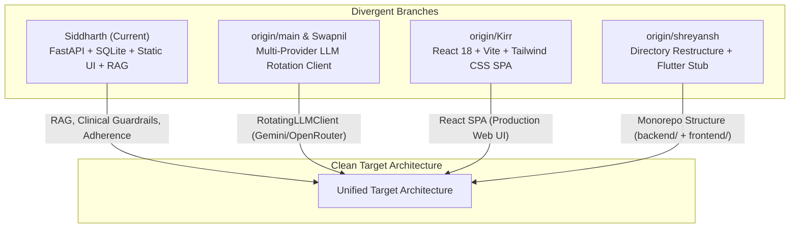

# AI DINCHARYA: FORENSIC CODEBASE AUDIT
## Document 08: Restart Disposition Register & Migration Strategy

**Audit Date:** 2026-10-13  
**Auditor:** Forensic Engineering Agent  
**Target Repository:** `SiddharthAmdal/AIDincharya`  
**Current Branch Assessed:** `Siddharth` (commit `f58c70f`)  
**Cross-Branch Merges:** `origin/main`, `origin/Swapnil`, `origin/Kirr`, `origin/shreyansh`

---

### 1. Executive Disposition Taxonomy

To ensure a seamless, high-velocity restart from a clean architectural foundation, every module, file, and subsystem has been evaluated and assigned an explicit disposition:

* **`RETAIN` (Keep As-Is):** The asset represents high-value, verified intellectual property, canonical grounding data, or robust domain schemas requiring only minor import adjustments.
* **`REPAIR` (Keep Logic, Fix Defects):** The core algorithmic or domain logic is sound, but contains concrete bugs, dead code, or unhandled edge cases that must be rectified.
* **`REDESIGN` (Re-architect Interface & Implementation):** The business intent is valid, but the existing architectural implementation violates separation of concerns, scalability, or clean design patterns.
* **`REPLACE` (Discard in Favor of Standard):** The current bespoke code should be discarded and replaced with an established industry-standard library, framework, or architectural pattern.
* **`REMOVE_CANDIDATE` (Delete / Purge):** Ephemeral artifacts, orphaned stubs, transient databases, or redundant legacy wrappers with zero forward value.

---

### 2. Comprehensive Component Disposition Register

| Path / Component | Current Responsibility | Proposed Disposition | Technical Justification | Target Architecture Destination |
| :--- | :--- | :--- | :--- | :--- |
| [`src/agent/models.py`](file:///Users/Siddharth/Documents/AiDincharya/src/agent/models.py) | Pydantic V2 Schemas for Schedule, Practices, Feedback, Telemetry | **RETAIN** | Well-designed, typed data contracts with validation fields and JSON schemas. | `backend/app/domain/models/schedule.py` |
| [`src/models.py`](file:///Users/Siddharth/Documents/AiDincharya/src/models.py) | Top-level Pydantic models (`DoshaVector`, `VikritiFlags`, `DoshaProfile`) | **RETAIN** | Clean mathematical domain models representing Ayurvedic constitutions. | `backend/app/domain/models/dosha.py` |
| [`src/knowledge/retriever.py`](file:///Users/Siddharth/Documents/AiDincharya/src/knowledge/retriever.py) | RAG Pipeline (`AyurvedaKnowledgeBase`, ChromaDB, MiniLM embeddings) | **REPAIR** | Vector search works reliably (25-50ms), but depends on heavy PyTorch binaries. Replace PyTorch with `fastembed` (ONNX) or remote embeddings. | `backend/app/adapters/rag/retriever.py` |
| [`src/knowledge/data/Core_Dinacharya_Grounding.pdf`](file:///Users/Siddharth/Documents/AiDincharya/src/knowledge/data/Core_Dinacharya_Grounding.pdf) | Canonical 20.9MB Ayurvedic text PDF | **RETAIN** | Core domain knowledge foundation; authoritative text for clinical grounding. | `backend/data/knowledge/Core_Dinacharya_Grounding.pdf` |
| [`src/knowledge/data/chroma/`](file:///Users/Siddharth/Documents/AiDincharya/src/knowledge/data/chroma/) | Local ChromaDB vector index directory (140 chunks) | **REMOVE_CANDIDATE** | Binary database should not be tracked in Git. Should be built dynamically on initialization via CLI seed script. | Dynamically generated in CI / runtime volume. |
| [`src/safety/guardrails.py`](file:///Users/Siddharth/Documents/AiDincharya/src/safety/guardrails.py) | Clinical Rule Engine and Contraindication Safety Boundary | **REPAIR** | Critical clinical safety boundary. Must remove Line 95 dead code (`block == cleaned_block`) and expand rule library beyond fever. | `backend/app/domain/clinical/guardrails.py` |
| [`src/behavior/tracker.py`](file:///Users/Siddharth/Documents/AiDincharya/src/behavior/tracker.py) | Adherence Tracker and BJ Fogg Behavioral Nudge Generator | **REPAIR** | Behavioral logic is sound. Must add exponential time decay to historical adherence and protect against zero division. | `backend/app/domain/behavior/tracker.py` |
| [`src/perception/dosha_mapper.py`](file:///Users/Siddharth/Documents/AiDincharya/src/perception/dosha_mapper.py) | Substring Prakriti & Vikriti Classification Stub | **REDESIGN** | Naive substring matching creates false positives. Replace with validated Ayurvedic questionnaire scoring engine and ML anomaly detector. | `backend/app/domain/perception/mapper.py` |
| [`src/agent/planner.py`](file:///Users/Siddharth/Documents/AiDincharya/src/agent/planner.py) | LangGraph Planning Orchestration Engine | **REDESIGN** | Tight coupling to deprecated NVIDIA model. Redesign with abstract LLM client, multi-provider failover, and streaming tokens. | `backend/app/services/planner/graph.py` |
| [`src/planning/agent.py`](file:///Users/Siddharth/Documents/AiDincharya/src/planning/agent.py) | Pass-through alias wrapper for `DinacharyaPlannerAgent` | **REMOVE_CANDIDATE** | Redundant 14-line boilerplate wrapper; merge directly into planning service. | Merged into `backend/app/services/planner/` |
| [`src/config.py`](file:///Users/Siddharth/Documents/AiDincharya/src/config.py) | Primitive `os.getenv` configuration dictionary | **REPLACE** | Replace with typed `pydantic-settings` `BaseSettings` class with startup validation and secret masking. | `backend/app/core/config.py` |
| [`src/database/db.py`](file:///Users/Siddharth/Documents/AiDincharya/src/database/db.py) | Raw SQLite script with unsalted SHA-256 and plaintext tokens | **REPLACE** | Critical security vulnerabilities (DEF-03, DEF-04). Replace with SQLAlchemy 2.0 / SQLModel + Alembic migrations + Bcrypt/Argon2 + JWT. | `backend/app/adapters/db/` |
| [`main.py`](file:///Users/Siddharth/Documents/AiDincharya/main.py) | 543-line monolithic API & HTML server | **REDESIGN** | Decompose into modular FastAPI APIRouter modules: `auth.py`, `routine.py`, `insights.py`, `chat.py`. | `backend/app/main.py` + `backend/app/api/routers/` |
| [`src/static/*`](file:///Users/Siddharth/Documents/AiDincharya/src/static/) | Vanilla HTML5 / JS / CSS (8 pages + `app.js`) | **REDESIGN** / **REPLACE** | Adopt `origin/Kirr` React 18 + Vite + TypeScript frontend, or package static files cleanly in a dedicated `frontend/` directory. | `frontend/` (Modern React SPA) |
| [`dinacharya.db`](file:///Users/Siddharth/Documents/AiDincharya/dinacharya.db) | Local SQLite development database (25 users) | **REMOVE_CANDIDATE** | Local unencrypted database artifact; exclude from Git and seed cleanly via migration scripts. | Excluded via `.gitignore` |
| [`browser_debug.log`](file:///Users/Siddharth/Documents/AiDincharya/browser_debug.log) | Client browser debug text log | **REMOVE_CANDIDATE** | Ephemeral runtime file; delete from repository root. | Excluded via `.gitignore` |
| [`tests/test_agent.py`](file:///Users/Siddharth/Documents/AiDincharya/tests/test_agent.py) | 15 Pytest unit test cases | **RETAIN** / **REPAIR** | High quality domain tests. Update to target new modular package paths. | `backend/tests/unit/test_domain.py` |
| [`test_flows.py`](file:///Users/Siddharth/Documents/AiDincharya/test_flows.py) | End-to-end integration test flow script | **REPAIR** | Valid API integration script; update endpoints and add bearer token headers. | `backend/tests/integration/test_flows.py` |
| [`test_flows2.py`](file:///Users/Siddharth/Documents/AiDincharya/test_flows2.py) | Secondary integration test script | **REMOVE_CANDIDATE** | Redundant duplicate of `test_flows.py`; merge into unified integration suite. | Merged into `backend/tests/integration/` |
| [`test_rag_and_agent.py`](file:///Users/Siddharth/Documents/AiDincharya/test_rag_and_agent.py) | RAG diagnostic standalone script | **REPAIR** | Fix Line 57 dictionary access bug (`schedule["schedule"].morning_block`). | `backend/scripts/diagnostics.py` |

---

### 3. Cross-Branch Asset Integration & Reconciliation Matrix

The Git audit identified significant divergence between team members' branches. Below is the reconciliation roadmap for the clean restart:



#### 3.1 Branch Evaluation & Selective Porting

1. **Port from `origin/main` / `origin/Swapnil`:**
   * **Asset:** `src/llm_client.py` (`RotatingLLMClient`).
   * **Value:** Implements multi-key failover and rate-limit retry logic across free-tier providers (OpenRouter, Gemini, NVIDIA).
   * **Action:** Refactor into `backend/app/adapters/llm/rotating_client.py` to permanently resolve DEF-01 (HTTP 410 EOL crashes).

2. **Port from `origin/Kirr`:**
   * **Asset:** React 18 + TypeScript + Vite SPA (`src/`, `package.json`, Tailwind config).
   * **Value:** Modern component-based user interface replacing raw string interpolation and static HTML manipulation in `app.js`.
   * **Action:** Adopt as the canonical web frontend in `frontend/`.

3. **Port from `origin/shreyansh`:**
   * **Asset:** Clear monorepo workspace organization (`backend/`, `frontend/`, `docs/`).
   * **Value:** Eliminates the confusion of having Python server files and browser static files co-located in the project root.
   * **Action:** Adopt the top-level directory hierarchy for the restarted repository.

---

### 4. Proposed Clean Architecture Target Structure

```text
AiDincharya/
├── .github/workflows/          # CI/CD: Linting, Unit & Integration Tests
├── docs/                       # Project documentation & clinical audit trails
│   └── codebase-audit/         # Complete 11 forensic audit deliverables
├── backend/                    # Python Backend Service
│   ├── app/
│   │   ├── api/                # FastAPI Routers & Dependencies
│   │   │   ├── v1/
│   │   │   │   ├── auth.py     # JWT Register, Login, Session Refresh
│   │   │   │   ├── routine.py  # Daily Schedule Generation & Updates
│   │   │   │   ├── chat.py     # Conversational Reasoning
│   │   │   │   ├── insights.py # Knowledge Graph Insights
│   │   │   │   └── health.py   # Liveness & Readiness Probes
│   │   │   └── deps.py         # Auth & Database Dependency Injections
│   │   ├── core/               # Configuration, Logging & Security
│   │   │   ├── config.py       # Pydantic BaseSettings
│   │   │   └── security.py     # Password Hashing (Argon2/Bcrypt) & JWT
│   │   ├── domain/             # Core Ayurvedic Clinical Logic (Pure Python)
│   │   │   ├── models/         # Pydantic Domain Schemas (Schedule, Dosha)
│   │   │   ├── clinical/       # Deterministic Safety & Contraindication Rules
│   │   │   ├── perception/     # Validated Dosha Scoring Rubric
│   │   │   └── behavior/       # Fogg Behavioral Model & Adherence Scoring
│   │   ├── services/           # Orchestration & Use Cases
│   │   │   ├── planner/        # LangGraph Multi-Agent Routine Planner
│   │   │   └── chat_service.py # Contextual Ayurvedic Assistant
│   │   └── adapters/           # External I/O Integrations
│   │       ├── db/             # SQLAlchemy 2.0 Models & Session Factories
│   │       ├── rag/            # Vector Knowledge Base & Retriever
│   │       └── llm/            # Multi-Provider Failover LLM Client
│   ├── alembic/                # Database Migrations
│   ├── tests/                  # Test Suites
│   │   ├── unit/               # Fast Domain Unit Tests (<100ms)
│   │   └── integration/        # Database & API Integration Tests
│   ├── pyproject.toml          # Modern Poetry / uv Dependency Manifest
│   └── uv.lock                 # Cryptographic Dependency Lockfile
├── frontend/                   # Modern Web Application (from branch Kirr)
│   ├── src/                    # React 18 + TypeScript Components
│   ├── package.json            # Node Dependencies
│   └── vite.config.ts          # Vite Bundler Configuration
└── README.md                   # Clean Architecture Developer Guide
```

---

### 5. Transition & Execution Phasing

1. **Phase 1: Environment & Workspace Reorganization**
   * Establish `backend/` and `frontend/` folders.
   * Lock dependencies via `uv` or `poetry`.
2. **Phase 2: Core Domain Porting (Zero External Dependencies)**
   * Move and clean `models.py`, `guardrails.py` (fix DEF-11), `tracker.py`, and `retriever.py`.
   * Port and unit-test pure domain logic in isolation.
3. **Phase 3: Security & Data Layer Modernization**
   * Implement SQLAlchemy models with proper relationships.
   * Introduce Argon2 password hashing and JWT authentication.
4. **Phase 4: Agent & LLM Resilience**
   * Port `RotatingLLMClient` from `origin/main` to eliminate HTTP 410 EOL failures.
   * Redesign LangGraph planning agent with robust fallback circuit breakers.
5. **Phase 5: API Router Decoupling & Frontend Integration**
   * Build modular FastAPI routers.
   * Connect `Kirr` React SPA via standard OpenAPI client.

---
*End of Document 08 (Baseline).*

---

### 5. Post-Implementation Reassessment Summary (October 14, 2026)

*Note: For the updated post-implementation disposition matrix, see [08_RESTART_OR_REPAIR_DISPOSITION.md](file:///Users/Siddharth/Documents/AiDincharya/docs/codebase-audit/08_RESTART_OR_REPAIR_DISPOSITION.md).*

Following targeted repair, new components have been added to the register:
- **`src/llm_gateway.py` (`PRESERVE / RETAIN`):** Centralized LLM resilience gateway.
- **`src/planning/tools.py` (`PRESERVE / RETAIN`):** Formal OpenAI function schemas & dispatcher.
- **`tests/test_llm_recovery.py` (`PRESERVE / RETAIN`):** 14-test regression suite.
- **`tests/test_routine_persistence.py` (`PRESERVE / RETAIN`):** 10-test persistence regression suite.
- **`scripts/benchmark_models.py` (`PRESERVE / RETAIN`):** 7-test candidate model benchmark framework.
- **`main.py` (`REDESIGN`):** Monolith expanded to 821 lines; must be split into modular routers.

