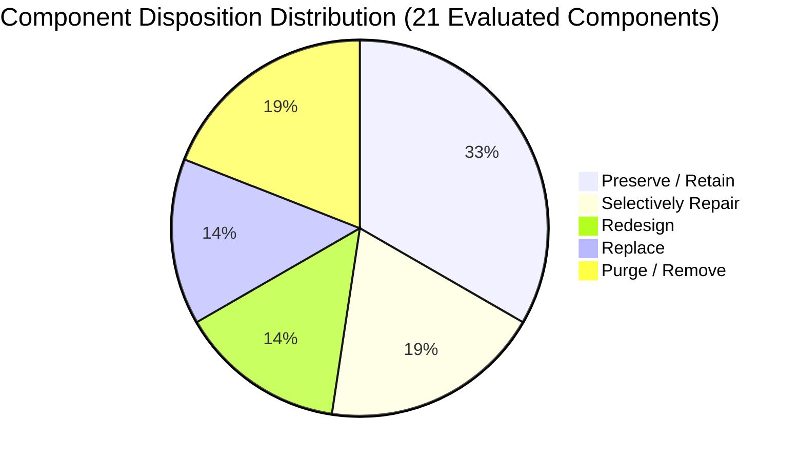

# AI DINCHARYA: COMPLETE CODEBASE FORENSIC AUDIT
## Document 08: Restart or Repair Disposition Register & Migration Strategy

**Reassessment Completion Date:** 2026-10-14  
**Baseline Audit Date:** 2026-10-13  
**Auditor:** Forensic Engineering Agent (DeepMind Antigravity)  
**Target Repository:** `SiddharthAmdal/AIDincharya` (Branch `Siddharth`, commit `9311925`)  

---

# PART 1: HISTORICAL BASELINE DISPOSITION REGISTER (October 13, 2026)
*Archival Record*

In the October 13 audit, 19 baseline repository components were classified across 5 dispositions:
- **`RETAIN` (4):** `src/agent/models.py`, `src/models.py`, `Core_Dinacharya_Grounding.pdf`, `tests/test_agent.py`.
- **`REPAIR` (5):** `src/knowledge/retriever.py`, `src/safety/guardrails.py`, `src/behavior/tracker.py`, `test_flows.py`, `test_rag_and_agent.py`.
- **`REDESIGN` (4):** `src/perception/dosha_mapper.py`, `src/agent/planner.py`, `main.py`, `src/static/*`.
- **`REPLACE` (2):** `src/config.py`, `src/database/db.py`.
- **`REMOVE_CANDIDATE` (5):** `dinacharya.db`, `browser_debug.log`, `chroma/`, `src/planning/agent.py`, `test_flows2.py`.

---

# PART 2: POST-IMPLEMENTATION REASSESSMENT DISPOSITION REGISTER (October 14, 2026)
*Current Authoritative Assessment Including All New & Modified Components*

### 2.1 Reassessment Disposition Taxonomy

To provide actionable guidance for the next phase of development, each component in the expanded codebase is classified according to its architectural viability:

1. **`PRESERVE / RETAIN` (High Value Asset):** Keep as-is or port with minor import path updates. Meets functional, security, and architectural standards.
2. **`SELECTIVELY REPAIR` (Viable Core with Targeted Defects):** Preserve the core algorithmic or domain implementation while fixing specific line-level defects, expanding test coverage, or resolving dependency bloat.
3. **`REDESIGN` (Sound Intent, Inadequate Architecture):** Retain business logic and domain rules, but completely decouple and restructure interfaces, routing, and workflows.
4. **`REPLACE` (Discard in Favor of Industry Standard):** Discard bespoke implementation in favor of established frameworks, ORMs, security libraries, or cryptographic primitives.
5. **`PURGE / REMOVE` (Zero Value / Transient Artifact):** Delete ephemeral runtime logs, unseeded binary files, or redundant historical scripts.

---

### 2.2 Comprehensive Component-by-Component Disposition Matrix

| Path / Component | Role & Responsibility | Reassessment Disposition | Technical Justification | Target Architecture Destination |
| :--- | :--- | :---: | :--- | :--- |
| **`src/llm_gateway.py`** | Centralized resilience gateway (Nemotron 30B, GPT-OSS-20B fallback, markdown/JSON fence stripping, token budgeting, tool execution loops). | **PRESERVE / RETAIN** | High-value infrastructure. Eliminates provider coupling, catches exceptions, and provides deterministic fallbacks. | `backend/app/adapters/llm/gateway.py` |
| **`src/planning/tools.py`** | Planner tools (`rag_ayurveda_search`, `check_clinical_safety`, `detect_calendar_conflicts`, `update_schedule_activity`) and execution dispatcher. | **PRESERVE / RETAIN** | Formal OpenAI function schemas and working execution dispatcher. Ready for direct agent binding. | `backend/app/domain/planning/tools.py` |
| **`tests/test_llm_recovery.py`** | 14 automated tests covering null schedules, insights resilience, JSON recovery, tool execution, and 6 circumstance adaptation scenarios. | **PRESERVE / RETAIN** | Critical regression test harness; 100% passing. | `backend/tests/integration/test_llm_recovery.py` |
| **`tests/test_routine_persistence.py`** | 10 automated regression tests verifying routine retrieval speedup, Trataka persistence, refresh survival, and DB error handling. | **PRESERVE / RETAIN** | High-value persistence verification suite; 100% passing. | `backend/tests/integration/test_routine_persistence.py` |
| **`scripts/benchmark_models.py`** | Standardized benchmark evaluating Candidate Models A, B, C across Tests A through G. | **PRESERVE / RETAIN** | Reusable model evaluation and regression framework. | `backend/scripts/benchmark_models.py` |
| **`src/models.py`** | Pydantic v2 domain schemas (`DoshaVector`, `VikritiFlags`, `DinacharyaSchedule`, `NotificationItem`). | **PRESERVE / RETAIN** | Complete, strongly typed data contracts with validation fields. | `backend/app/domain/models/` |
| **`Core_Dinacharya_Grounding.pdf`** | 20.9MB canonical Ayurvedic text (Ashtanga Hridaya). | **PRESERVE / RETAIN** | Authoritative foundation for Ayurvedic RAG. | `backend/data/knowledge/Core_Dinacharya_Grounding.pdf` |
| **`src/knowledge/retriever.py`** | ChromaDB RAG vector store query engine (140 chunks, sub-40ms cosine search). | **SELECTIVELY REPAIR** | Retrieval logic is fast and accurate. Must eliminate PyTorch dependency bloat (~2GB) by migrating to `fastembed` (ONNX). | `backend/app/adapters/rag/retriever.py` |
| **`src/safety/guardrails.py`** | Clinical safety engine and deterministic contraindication boundary. | **SELECTIVELY REPAIR** | Architecture is deterministic and unbypassable. Must remove Line 95 dead code (`block == cleaned_block`) and expand rule library beyond fever. | `backend/app/domain/clinical/guardrails.py` |
| **`src/behavior/tracker.py`** | BJ Fogg behavioral adherence tracker and complexity tier scaler. | **SELECTIVELY REPAIR** | Core tier scaling logic is sound. Must add exponential time decay weighting to adherence scoring. | `backend/app/domain/behavior/tracker.py` |
| **`src/planning/agent.py`** | LangGraph planning agent and circumstance adaptation logic. | **REDESIGN** | Circumstance adaptation logic is sound, but graph remains a rigid 3-node sequential pipeline. Re-architect with cyclic critique and native tool calling. | `backend/app/services/planner/` |
| **`main.py`** | 821-line monolithic FastAPI server (routes, auth, business logic, static mounts). | **REDESIGN** | Unmaintainable monolith (DEF-08). Split into modular APIRouters: `auth.py`, `schedule.py`, `chat.py`, `notifications.py`, `insights.py`. | `backend/app/api/v1/` |
| **`src/perception/dosha_mapper.py`**| 3-question form with keyword substring matching. | **REDESIGN** | Naive substring matching (DEF-12) causes false positives. Replace with validated clinical questionnaire rubric and Isolation Forest anomaly detector. | `backend/app/domain/perception/` |
| **`src/static/*` (`app.js`, HTML)** | Vanilla HTML/Tailwind templates and client JavaScript. | **REPLACE** | Replace with `origin/Kirr`'s modern React 18 + Vite + TypeScript frontend, or bundle static assets cleanly into a dedicated `frontend/` package. | `frontend/` (React SPA) |
| **`src/database/db.py`** | Raw SQLite database layer, unsalted SHA-256, plaintext bearer tokens. | **REPLACE** | Critical security vulnerabilities (DEF-03, DEF-04). Replace with SQLAlchemy 2.0 / PostgreSQL + Alembic migrations + Argon2id + signed JWTs. | `backend/app/adapters/db/` |
| **`src/config.py`** | `os.getenv` configuration with hardcoded placeholder secrets. | **REPLACE** | Replace with typed Pydantic `BaseSettings` class with startup validation and secret masking. | `backend/app/core/config.py` |
| **`dinacharya.db`** | Local unencrypted SQLite binary database. | **PURGE / REMOVE** | Exclude binary database from Git tracking; generate dynamically via migration and seed scripts. | Excluded via `.gitignore` |
| **`src/knowledge/data/chroma/`** | Pre-built ChromaDB SQLite and HNSW vector index files. | **PURGE / REMOVE** | Exclude compiled index files from Git; build dynamically during setup via RAG ingest script. | Excluded via `.gitignore` |
| **`browser_debug.log`** | 2,549-line browser debug log file in repository root. | **PURGE / REMOVE** | Delete ephemeral runtime log from repository root. | Excluded via `.gitignore` |
| **`test_rag_and_agent.py`** | Standalone diagnostic script with Line 57 `AttributeError`. | **SELECTIVELY REPAIR** | Fix dictionary access bug (`schedule["schedule"].morning_block`). | `backend/scripts/diagnostics.py` |
| **`test_flows2.py`** | Secondary integration script with unchecked response codes. | **PURGE / REMOVE** | Redundant; covered by `tests/test_routine_persistence.py`. | Merged into Pytest suite |

---

### 2.3 Disposition Summary by Category

| Disposition Category | Component Count | Action Summary |
| :--- | :---: | :--- |
| **`PRESERVE / RETAIN`** | **7** | `src/llm_gateway.py`, `src/planning/tools.py`, `src/models.py`, `Core_Dinacharya_Grounding.pdf`, `test_llm_recovery.py`, `test_routine_persistence.py`, `benchmark_models.py`. |
| **`SELECTIVELY REPAIR`** | **4** | `src/knowledge/retriever.py`, `src/safety/guardrails.py`, `src/behavior/tracker.py`, `test_rag_and_agent.py`. |
| **`REDESIGN`** | **3** | `main.py` (modularize routers), `src/planning/agent.py` (iterative tool-calling graph), `src/perception/dosha_mapper.py` (validated scoring rubric). |
| **`REPLACE`** | **3** | `src/config.py` (Pydantic BaseSettings), `src/database/db.py` (SQLAlchemy 2.0 + Argon2 + JWT), `src/static/*` (React 18 SPA). |
| **`PURGE / REMOVE`** | **4** | `dinacharya.db`, `chroma/` binary directory, `browser_debug.log`, `test_flows2.py`. |

---
*End of Document 08. Restart or Repair Disposition Register Complete.*
