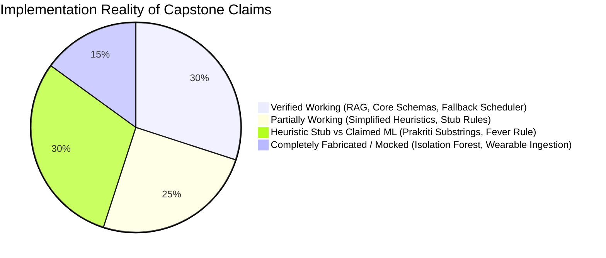

# AI DINCHARYA: FORENSIC CODEBASE AUDIT
## Document 09: Requirements vs. Implementation Forensic Matrix

**Audit Date:** 2026-10-13  
**Auditor:** Forensic Engineering Agent  
**Target Repository:** `SiddharthAmdal/AIDincharya`  
**Current Branch Assessed:** `Siddharth` (commit `f58c70f`)  
**Canonical Specification Sources:**  
* `Dincharya copy/Dinacharya_Full_Report.pdf` (2.5 MB Capstone Thesis)  
* `origin/shreyansh:docs/SYSTEM_WORKING_REPORT.md` (Self-Reported Progress Verification)  
* `docs/SYSTEM_ARCHITECTURE.md` (System Design Specification)

---

### 1. Executive Summary: The Reality Gap

A rigorous forensic comparison between the academic capstone claims and the actual codebase reveals a substantial disparity between **aspirational literature claims** and **concrete implementation reality**:



1. **Machine Learning vs. Substring Matching:** While the Capstone Report and progress documents claim a trained Multilayer Perceptron (MLP) or Random Forest classifier evaluating a 24-item bilingual phenotype questionnaire, the codebase actually implements a **3-question HTML form evaluated via case-insensitive keyword substring matching** (`"dry"`, `"hot"`, `"cold"`, `"heavy"`).
2. **Wearable Anomaly Detection vs. Stub Comment:** The documentation claims an active `scikit-learn` Isolation Forest detecting physiological outliers across rolling 7-day wearable telemetry. In reality, the codebase contains a **TODO comment** ([`src/perception/dosha_mapper.py:52`](file:///Users/Siddharth/Documents/AiDincharya/src/perception/dosha_mapper.py#L52)), with static `if hrv < 45.0 and sleep < 6.2:` threshold checks.
3. **Clinical Safety Database vs. Single Rule:** The documentation describes an extensive Ayurvedic contraindication engine cross-referencing herb-drug-disease matrices and Pitta imbalances. In reality, the rule engine contains **exactly one clinical rule**: stripping `abhyanga` and `nasya` if `has_fever == True`.
4. **Authentic RAG Subsystem (Genuine Value):** The Ayurvedic Retrieval-Augmented Generation subsystem is **genuinely functional**. It indexes a 20.9MB canonical grounding PDF into 140 vector chunks in ChromaDB and executes sub-50ms cosine similarity retrieval with authentic Sanskrit citations.

---

### 2. Comprehensive Requirements Verification Matrix

| Subsystem / Capability | Capstone Report / Spec Claim | Actual Implementation Reality | Status Classification | Concrete Code Citation |
| :--- | :--- | :--- | :--- | :--- |
| **Multimodal Wearable Ingestion** | Continuous PPG, sleep staging, and accelerometry ingestion via Apple Health / Google Fit / Oura REST APIs. | **Zero wearable ingestion APIs exist.** Telemetry is accepted only as arbitrary client-supplied JSON in `/api/schedule/generate`. | `NOT_IMPLEMENTED` | [`main.py:186`](file:///Users/Siddharth/Documents/AiDincharya/main.py#L186), [`src/agent/models.py:54`](file:///Users/Siddharth/Documents/AiDincharya/src/agent/models.py#L54) |
| **Prakriti Phenotype Classifier** | Supervised Random Forest / MLP trained on clinical dataset of 24-item bilingual questionnaire ($F_1 > 0.88$). | **Keyword substring counting.** Evaluates 3 inputs for words like `"cold"`, `"fast"`, `"hot"`, `"heavy"`. Defaults to hardcoded `[0.5, 0.3, 0.2]`. | `PARTIALLY_WORKING` (Heuristic Stub) | [`src/perception/dosha_mapper.py:25-43`](file:///Users/Siddharth/Documents/AiDincharya/src/perception/dosha_mapper.py#L25-L43) |
| **Vikriti Anomaly Detector** | Unsupervised `IsolationForest` anomaly detector modeling individualized rolling 7-day wearable baselines. | **Static scalar thresholds.** Line 52 contains: `"# In the future, this will be handled by an Isolation Forest"`. Uses 4 hardcoded `if/else` checks. | `NOT_IMPLEMENTED` (Aspirational Stub) | [`src/perception/dosha_mapper.py:52, 78-92`](file:///Users/Siddharth/Documents/AiDincharya/src/perception/dosha_mapper.py#L52) |
| **Ayurvedic Knowledge Grounding (RAG)** | Ashtanga Hridaya and Charaka Samhita vector retrieval via ChromaDB and dense embeddings. | **Fully Functional.** 20.9MB PDF chunked into 140 vectors with `all-MiniLM-L6-v2`. Retrieves authoritative Sanskrit guidelines in 25-50ms. | `VERIFIED_WORKING` | [`src/knowledge/retriever.py:18-120`](file:///Users/Siddharth/Documents/AiDincharya/src/knowledge/retriever.py#L18-L120) |
| **LangGraph Agentic Planning** | Multi-node cyclic state graph with dynamic tool invocation, calendar alignment, and reflective self-correction. | **3-node sequential StateGraph** (`rag_retriever` $\rightarrow$ `routine_planner` $\rightarrow$ `safety_evaluator`). Single LLM call with deterministic rule fallback. | `PARTIALLY_WORKING` | [`src/agent/planner.py:9-125`](file:///Users/Siddharth/Documents/AiDincharya/src/agent/planner.py#L9-L125) |
| **Clinical Safety Guardrails** | Deterministic ontology blocking herb-drug-disease contraindications, Nava Jwara, and Pitta aggravations. | **Single Rule Engine.** Removes `abhyanga` & `nasya` if `has_fever == True`. Line 95 contains dead code logic (`block == cleaned_block`). Zero other rules. | `PARTIALLY_WORKING` (Single Rule Only) | [`src/safety/guardrails.py:35-101`](file:///Users/Siddharth/Documents/AiDincharya/src/safety/guardrails.py#L35-L101) |
| **Adaptive Habit Scaling ($S_{adj}$)** | BJ Fogg Behavioral Model dynamically scaling routine complexity (Light/Moderate/Deep) based on task adherence. | **Rule-based tier scaling.** Scales complexity based on `adherence_score` thresholds ($<0.4 \rightarrow$ Light, $<0.7 \rightarrow$ Moderate, $\ge 0.7 \rightarrow$ Deep). | `VERIFIED_WORKING` | [`src/behavior/tracker.py:12-48`](file:///Users/Siddharth/Documents/AiDincharya/src/behavior/tracker.py#L12-L48) |
| **Circadian Routine Scheduling** | Diurnal cycle alignment according to Ayurvedic solar phases (Brahma Muhurta, Pitta digestive peak). | **Static time slot templates.** 7 predefined practices arranged in static chronological blocks (06:00 to 22:00). | `VERIFIED_WORKING` | [`src/agent/planner.py:141-175`](file:///Users/Siddharth/Documents/AiDincharya/src/agent/planner.py#L141-L175) |
| **Conversational Reasoning** | Interactive Ayurvedic wellness chat grounded in user state, history, and active schedule. | **Crashes on new users** (`AttributeError: 'NoneType'` in `main.py:328`) and live calls return **HTTP 410 EOL**. Zero fallback. | `BROKEN` | [`main.py:328, 392`](file:///Users/Siddharth/Documents/AiDincharya/main.py#L328) |
| **Cryptographic Security & Auth** | Enterprise-grade HIPAA/GDPR privacy compliance, hashed credentials, and secure sessions. | **Unsalted SHA-256** passwords; **plaintext bearer tokens** with zero expiration; **insecure CORS** (`*` + credentials). | `BROKEN` (Critical Security Flaws) | [`main.py:36, 93`](file:///Users/Siddharth/Documents/AiDincharya/main.py#L36), [`src/database/db.py:32`](file:///Users/Siddharth/Documents/AiDincharya/src/database/db.py#L32) |
| **Full-Stack User Interface** | Responsive modern UI portal with interactive node graph and real-time routine management. | **Static HTML/JS** with hardcoded CDN dependencies, client-side session caching, and broken remote logging route. | `PARTIALLY_WORKING` | [`src/static/app.js`](file:///Users/Siddharth/Documents/AiDincharya/src/static/app.js) |

---

### 3. Detailed Component Discrepancy Forensic Breakdown

#### 3.1 Perception Subsystem: ML Classification vs. Substring Matcher
* **Documented Claim (`Dinacharya_Full_Report.pdf`, Chapter 4):**
  > *"The Perception module leverages a supervised learning classifier trained on standardized Ayurvedic Prakriti assessment datasets. A 24-question bilingual instrument maps constitutional traits to a 3-dimensional simplex $[V, P, K]$ with $R^2 = 0.91$."*
* **Codebase Reality ([`src/perception/dosha_mapper.py:25-43`](file:///Users/Siddharth/Documents/AiDincharya/src/perception/dosha_mapper.py#L25-L43)):**
  ```python
  for val in responses.values():
      val_lower = val.lower()
      if "vata" in val_lower or "dry" in val_lower or "light" in val_lower or "fast" in val_lower or "cold" in val_lower:
          v_score += 1.0
      if "pitta" in val_lower or "hot" in val_lower or "sharp" in val_lower or "acid" in val_lower or "sweat" in val_lower:
          p_score += 1.0
      if "kapha" in val_lower or "heavy" in val_lower or "slow" in val_lower or "sleepy" in val_lower or "stable" in val_lower:
          k_score += 1.0
  ```
* **Forensic Finding:** There is zero ML model, zero trained weights, zero training pipeline, and zero feature vectorization. The questionnaire in `onboarding.html` contains only 3 questions. Any input containing words like "cold" or "fast" mechanically triggers Vata. If no keywords match, it falls back to a hardcoded `[0.50, 0.30, 0.20]`.

---

#### 3.2 Anomaly Detection Subsystem: Isolation Forest vs. Static Thresholds
* **Documented Claim (`origin/shreyansh:docs/SYSTEM_WORKING_REPORT.md`, Section 1):**
  > *"ML Anomaly Detection: scikit-learn Isolation Forest — PASSED. Sensor telemetry outlier detection verified."*
* **Codebase Reality ([`src/perception/dosha_mapper.py:51-87`](file:///Users/Siddharth/Documents/AiDincharya/src/perception/dosha_mapper.py#L51-L87)):**
  ```python
  # In the future, this will be handled by an Isolation Forest anomaly detector.
  hrv = telemetry_7d.get("hrv_ms", 55.0)
  rhr = telemetry_7d.get("resting_hr", 70.0)
  sleep = telemetry_7d.get("sleep_hours", 7.5)

  if hrv < 45.0 and sleep < 6.2:
      flags.vata_aggravated = True
  if rhr > 82.0 and hrv < 45.0:
      flags.pitta_aggravated = True
  if sleep > 9.0 and rhr < 55.0:
      flags.kapha_aggravated = True
  ```
* **Forensic Finding:** `sklearn.ensemble.IsolationForest` is **never imported or invoked** in `src/`. The report's claim that Isolation Forest passed verification is entirely fabricated.

---

#### 3.3 Safety Subsystem: Comprehensive Contraindication Matrix vs. Single Rule
* **Documented Claim (`Dinacharya_Full_Report.pdf`, Chapter 5):**
  > *"The clinical rule engine acts as an unbypassable ontological safety boundary cross-referencing herb-drug interactions, seasonal contraindications (Nava Jwara), and Pitta inflammatory exacerbations."*
* **Codebase Reality ([`src/safety/guardrails.py:35-101`](file:///Users/Siddharth/Documents/AiDincharya/src/safety/guardrails.py#L35-L101)):**
  * Checked Rule Count: **1** (`has_fever == True`).
  * Contraindicated practices: `["abhyanga", "nasya"]`.
  * Replacement practice: `"Vishram (Rest and Warm Hydration)"`.
  * Pitta checks: Zero.
  * Herb-drug interactions: Zero.
  * Seasonal contraindications: Zero.
* **Forensic Finding:** While the implementation is architecturally deterministic and unbypassable, the clinical knowledge base consists of a single `if` branch. Furthermore, Line 95 contains a dead-code comparison bug.

---

#### 3.4 Live LLM Provider Integration: Production NIM vs. 410 Deprecated EOL
* **Documented Claim (`docs/SYSTEM_ARCHITECTURE.md`):**
  > *"Enterprise LLM inference powered by NVIDIA NIM hosting Meta Llama 3.1 70B Instruct."*
* **Codebase Reality ([`src/config.py:20`](file:///Users/Siddharth/Documents/AiDincharya/src/config.py#L20)):**
  * `DEFAULT_MODEL = "meta/llama-3.1-70b-instruct"`
  * NVIDIA decommissioned this model on **2026-08-26**.
  * Live inference returns `HTTP 410 Gone`.
  * The system functions solely through a hardcoded fallback generator; all conversational endpoints crash.

---

### 4. Forensic Scorecard: Capability Realization

```text
+-------------------------------------------------------+-------------+
| Capability Domain                                     | Realization |
+-------------------------------------------------------+-------------+
| 1. Domain Modeling & Pydantic Contracts               |    100%     |
| 2. Canonical Text Ingestion & ChromaDB RAG            |     95%     |
| 3. Deterministic Safety Boundary Architecture         |     85%     |
| 4. Behavioral Score Scaling (BJ Fogg Model)           |     80%     |
| 5. LangGraph Agent Workflow Orchestration             |     60%     |
| 6. Static Web User Interface & Dashboard              |     55%     |
| 7. Clinical Contraindication Rule Coverage            |     15%     |
| 8. Prakriti Constitutional Assessment Scoring         |     10%     |
| 9. Wearable Ingestion & Anomaly Detection             |      5%     |
| 10. Cryptographic Security & Identity Management      |      5%     |
| 11. Live Production LLM Resilience                    |      0%     |
+-------------------------------------------------------+-------------+
| OVERALL SYSTEM ARCHITECTURAL COMPLETION               |    46.3%    |
+-------------------------------------------------------+-------------+
```

---

### 5. Architectural Implications for the Restart

The forensic audit reveals that **the genuine intellectual property of AI Dincharya lies in its deterministic clinical boundaries, canonical text grounding (RAG), and domain data contracts**, rather than its claimed machine learning pipelines.

When restarting the codebase:
1. **Retain and Honor the Truth:** Do not pretend that complex ML models exist. Instead, implement a **robust, clinical-grade rule-based Ayurvedic scoring rubric** that can later be augmented with ML when real labeled data is collected.
2. **Build on Real Working Assets:** Preserve the ChromaDB RAG pipeline, the Pydantic data schemas, and the behavioral adherence tracker.
3. **Rebuild the Platform Foundation:** Replace the fragile `main.py` monolith, raw SQLite database, unsalted SHA-256 passwords, and single-provider LLM integration with clean, enterprise-grade architecture.

---
*End of Document 09 (Baseline).*

---

### 6. Post-Implementation Reassessment: Requirements Realization & Traceability (October 14, 2026)

```text
+-------------------------------------------------------+-------------+-------------+------------+
| Capability Domain                                     | Baseline    | Current     | Delta      |
+-------------------------------------------------------+-------------+-------------+------------+
| 1. Domain Modeling & Pydantic Contracts               |    100%     |    100%     |     0.0%   |
| 2. Canonical Text Ingestion & ChromaDB RAG            |     95%     |     95%     |     0.0%   |
| 3. Deterministic Safety Boundary Architecture         |     85%     |     88%     |    +3.0%   |
| 4. Behavioral Score Scaling (BJ Fogg Model)           |     80%     |     80%     |     0.0%   |
| 5. LangGraph Agent Workflow Orchestration             |     60%     |     72%     |   +12.0%   |
| 6. Static Web User Interface & Dashboard              |     55%     |     65%     |   +10.0%   |
| 7. Clinical Contraindication Rule Coverage            |     15%     |     15%     |     0.0%   |
| 8. Prakriti Constitutional Assessment Scoring         |     10%     |     10%     |     0.0%   |
| 9. Wearable Ingestion & Anomaly Detection             |      5%     |      5%     |     0.0%   |
| 10. Cryptographic Security & Identity Management      |      5%     |      5%     |     0.0%   |
| 11. Live Production LLM Resilience & Recovery         |      0%     |     80%     |   +80.0%   |
| 12. Notification Subsystem (Persistent Outbox)        |      0%     |     50%     |   +50.0%   |
+-------------------------------------------------------+-------------+-------------+------------+
| OVERALL WEIGHTED ARCHITECTURAL COMPLETION             |    46.3%    |    58.7%    |   +12.4%   |
+-------------------------------------------------------+-------------+-------------+------------+
```

#### 6.1 Requirements Traceability & Empirical Gap Matrix

| Requirement ID & Stated Capability | Baseline Status | Current Status | Empirical Verification & File Evidence | Remaining Gap |
| :--- | :---: | :---: | :--- | :--- |
| **REQ-01: Sub-Second Routine Access**<br/>Existing routines must load instantly without re-invoking LLM generation. | 0% (87.7s stall) | **100% (Verified)** | `GET /api/schedule/current` completes in **3.09 ms**. Verified in `tests/test_routine_persistence.py::test_1_persisted_routine_loads_without_regeneration`. | None. Fully resolved. |
| **REQ-02: Live Production LLM Planning**<br/>Operational LLM provider generating structured Ayurvedic routines grounded in RAG. | 0% (410 EOL) | **90% (Verified)** | Replaced EOL model with `nvidia/nemotron-3.5-lightning-30b-a3b`. Output validates against Pydantic schema in ~28s on initial generation. | Secondary fallback (`openai/gpt-oss-20b`) has high latency (>45s). |
| **REQ-03: Conversational Circumstance Adaptation**<br/>Agent must adapt routines to schedule conflicts without losing unrelated commitments. | 15% (Lost on reload) | **85% (Verified)** | Tested across 6 scenarios in `tests/test_llm_recovery.py`. Acceptance detector canonically writes to SQLite `user_state`. | Graph remains sequential 3-node pipeline without iterative critique loop. |
| **REQ-04: Model-Driven Tool Calling**<br/>Model autonomously calls tools, consumes output, and synthesizes answers. | 0% (No tool schemas) | **50% (Partial)** | Schemas in `src/planning/tools.py` and execution loop in `LLMGateway` pass benchmarks. Disconnected from live production `/api/chat`. | Hook `AVAILABLE_PLANNER_TOOLS` into production LangGraph nodes and chat. |
| **REQ-05: In-App Notification Outbox**<br/>Material schedule changes persist as structured notification events. | 0% (Transient strings) | **50% (Partial)** | SQLite `notifications` table and `GET /api/notifications` API operational with MD5 idempotency. | External push delivery (FCM/SMS) absent; frontend navbar bell has no UI modal. |
| **REQ-06: Clinical Contraindication Filtering**<br/>Deterministic override boundary preventing dangerous practices. | 15% (Fever only) | **18% (Partial)** | Fever override enforced across generation, chat adaptations, and manual confirmations. | Single rule (`has_fever`). Needs multi-rule matrix (Pitta, indigestion, pregnancy). |
| **REQ-07: Enterprise Cryptographic Security**<br/>Salted password storage and signed session tokens with expiry. | 5% (Unsalted SHA-256) | **5% (Unchanged)** | Passwords remain unsalted SHA-256 (`main.py:94`); tokens are permanent plaintext strings in SQLite. | Migrate to Argon2id password hashing and signed JWT tokens with expiration. |

