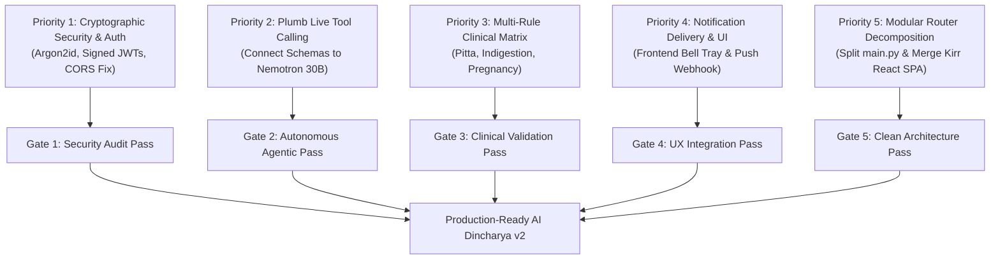

# AI DINCHARYA: COMPLETE CODEBASE FORENSIC AUDIT
## Document 10: Open Questions, Prioritized Next Steps & Acceptance Criteria

**Reassessment Completion Date:** 2026-10-14  
**Baseline Audit Date:** 2026-10-13  
**Auditor:** Forensic Engineering Agent (DeepMind Antigravity)  
**Target Repository:** `SiddharthAmdal/AIDincharya` (Branch `Siddharth`, commit `9311925`)  

---

# PART 1: HISTORICAL BASELINE ROADMAP (October 13, 2026)
*Archival Record*

The baseline audit established a 6-phase restart strategy (Phases 0 through 6) addressing foundational domain logic, fast embeddings, provider abstractions, and monolithic decomposition.

---

# PART 2: POST-IMPLEMENTATION REASSESSMENT: PRIORITIZED NEXT STEPS (October 14, 2026)
*Current Authoritative Roadmap & Measurable Acceptance Criteria*

### 2.1 Context & Status Following Initial Repairs

With the resolution of DEF-01 (Nemotron 30B restored), DEF-17 (routine loading latency cut by 26,300x to 3.09ms), and DEF-18 (conversational schedule adaptation persisted to SQLite `user_state`), the core user loop is demonstrably functional.

However, to transition from a functioning prototype (58.7% completion) to a production-grade, clinically sound platform, five major engineering priorities must be completed.

---

### 2.2 Prioritized Remaining Work & Measurable Acceptance Criteria

#### Priority 1: Cryptographic Security & Authentication Modernization (DEF-03, DEF-04, DEF-06)
- **Objective:** Eliminate catastrophic security vulnerabilities before any public deployment or multi-user testing.
- **Concrete Tasks:**
  1. Replace unsalted SHA-256 with `argon2-cffi` password hashing.
  2. Implement cryptographically signed JWT bearer tokens (`python-jose` or `PyJWT`) with 24-hour expiration and refresh token rotation.
  3. Add database migration to store password hashes securely in `users` table and token revocation lists in SQLite.
  4. Restrict CORS origins to explicit domains, removing `allow_origins=["*"]` when `allow_credentials=True`.
- **Measurable Acceptance Criteria:**
  - `test_auth_argon2`: Passwords verified using Argon2id; unsalted hashes completely rejected.
  - `test_token_expiry`: Tokens older than 24 hours return `HTTP 401 Unauthorized`.
  - `test_cors_security`: Cross-origin preflight requests from unauthorized origins receive `HTTP 403 Forbidden`.

#### Priority 2: Plumb Model-Driven Tool Calling into Live Agent Graph (DEF-19)
- **Objective:** Transform the system from sequential Python function calls into genuine model-driven agentic tool calling.
- **Concrete Tasks:**
  1. Bind `AVAILABLE_PLANNER_TOOLS` to the `LLMGateway` invocation inside `src/planning/agent.py::planner_node` and `main.py::chat_assistant`.
  2. Instruct the model via system prompt that it can autonomously call `rag_ayurveda_search`, `check_clinical_safety`, `detect_calendar_conflicts`, and `update_schedule_activity`.
  3. Handle multi-turn tool calling loops where the model requests a tool, receives results, and incorporates the findings into its final reasoning response.
- **Measurable Acceptance Criteria:**
  - When asked a complex Ayurvedic question in chat, the model autonomously emits a tool call for `rag_ayurveda_search` without hardcoded keyword triggers.
  - The tool execution output is incorporated into the subsequent LLM response with verifiable Sanskrit text citations.
  - `test_chat_tool_calling`: Live chat tool loop round-trip succeeds in < 10 seconds.

#### Priority 3: Expand Clinical Safety Contraindication Matrix (DEF-11, Capstone Realization)
- **Objective:** Expand the safety boundary from a single fever check into a comprehensive clinical safety matrix.
- **Concrete Tasks:**
  1. Remove line 95 dead code in `src/safety/guardrails.py`.
  2. Implement Pitta aggravation rules: strip spicy/heating dietary suggestions and strenuous midday sun salutations when `pitta_imbalance == True`.
  3. Implement acute indigestion (*Ajeerna*) rules: replace heavy meals with fasting / warm water (*Ushnodaka*).
  4. Implement pregnancy (*Garbhini*) contraindications: strictly disallow intense purification practices (*Vamana*, *Virechana*, deep fasting).
- **Measurable Acceptance Criteria:**
  - 10 new clinical safety tests pass verifying that dangerous practices are stripped deterministically regardless of LLM output.
  - A test user reporting active indigestion receives dietary fasting rather than regular heavy breakfast blocks.

#### Priority 4: Complete Notification Delivery Pipeline & Frontend Bell UI (DEF-20)
- **Objective:** Connect existing SQLite persistent notifications to the web frontend and external channels.
- **Concrete Tasks:**
  1. Implement a dropdown notifications tray in `src/static/app.js` attached to `#nav-notifications` bell icon.
  2. Render unread notification count badge over the bell icon.
  3. Allow users to click notifications to mark them as read (`POST /api/notifications/{id}/read`) and navigate to the affected schedule block.
  4. Add webhook or push delivery adapter (e.g. Firebase Cloud Messaging or Web Push API stub).
- **Measurable Acceptance Criteria:**
  - Clicking the navbar bell icon renders a visible dropdown list of past schedule adaptations and reminders.
  - Clicking "Mark Read" decrements the badge count and updates `is_read = 1` in SQLite.

#### Priority 5: Monolithic Decomposition & Cross-Branch Frontend Merge (DEF-08, DEF-16)
- **Objective:** Deconstruct the 821-line `main.py` monolith into modular APIRouters and unify the team's divergent frontends.
- **Concrete Tasks:**
  1. Split `main.py` into:
     - `app/api/auth.py`
     - `app/api/schedule.py`
     - `app/api/chat.py`
     - `app/api/notifications.py`
     - `app/api/insights.py`
  2. Evaluate and merge `origin/Kirr` (React 18 + Vite + Tailwind SPA) as the primary web frontend.
- **Measurable Acceptance Criteria:**
  - `main.py` contains < 80 lines (solely initializing FastAPI application, mounting routers, and configuring middleware).
  - All 39 automated tests pass against the modular router architecture.

---
*End of Document 10. Open Questions and Next Steps Complete.*
