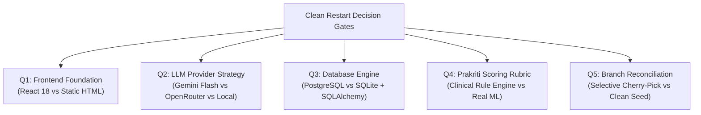
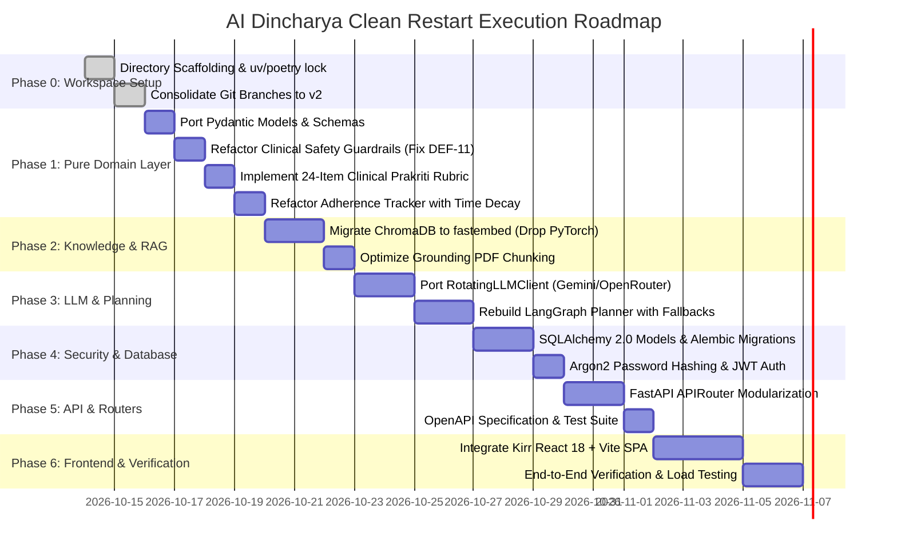

# AI DINCHARYA: FORENSIC CODEBASE AUDIT
## Document 10: Open Questions and Recommended Next Steps

**Audit Date:** 2026-10-13  
**Auditor:** Forensic Engineering Agent  
**Target Repository:** `SiddharthAmdal/AIDincharya`  
**Current Branch Assessed:** `Siddharth` (commit `f58c70f`)  
**Cross-Branch References:** `origin/main`, `origin/Swapnil`, `origin/Kirr`, `origin/shreyansh`

---

### 1. Executive Summary: Restart Objectives

With the completion of this forensic audit, the engineering team possesses a comprehensive, evidence-backed inventory of every line of code, defect, and asset in AI Dincharya. 

The objective of the clean restart is **not to throw away existing domain value**, but to:
1. **Preserve High-Value Intellectual Property:** Protect the canonical Ayurvedic text grounding (ChromaDB RAG), Pydantic domain models, deterministic safety boundaries, and behavioral adherence logic.
2. **Eliminate Critical Vulnerabilities:** Replace unsalted SHA-256 password hashes, permanent plaintext bearer tokens, permissive CORS policies, and unhandled `NoneType` null-pointer exceptions.
3. **Resolve Live Outages:** Terminate reliance on deprecated NVIDIA NIM models (HTTP 410 EOL) by instituting multi-provider rotation and streaming fallbacks.
4. **Unify Team Development:** Consolidate the 4 divergent Git branches into a single clean monorepo architecture.

---

### 2. Key Architectural Open Questions Requiring Alignment

#### Q1: Frontend Stack Selection — React 18 SPA vs. Static Vanilla HTML
* **Context:** Branch `Siddharth` has 8 static HTML pages and a 398-line `app.js` file. Branch `Kirr` built a full React 18 + TypeScript + Vite + Tailwind SPA. Branch `shreyansh` initiated a Flutter mobile stub.
* **Trade-Offs:**
  * *Option A (Recommended):* Adopt `Kirr`'s React 18 + TypeScript frontend into `frontend/`. Provides type-safe component state, modularity, and modern reactive UX.
  * *Option B:* Retain the static HTML files as a lightweight fallback or server-rendered admin portal.
* **Decision Gate:** Team must confirm whether React 18 is the primary target for production.

---

#### Q2: LLM Provider & Inference Strategy
* **Context:** `meta/llama-3.1-70b-instruct` on NVIDIA NIM is permanently EOL (HTTP 410). Branch `Swapnil` introduced `RotatingLLMClient` with Gemini and OpenRouter provider failovers.
* **Trade-Offs:**
  * *Option A (Recommended):* Implement a multi-provider adapter in `backend/app/adapters/llm/` supporting:
    1. Primary: Google Gemini 1.5/2.0 Flash (high speed, generous free tier, structured JSON mode).
    2. Fallback 1: OpenRouter (free tier Meta Llama 3.3 70B / DeepSeek V3).
    3. Fallback 2: Deterministic Ayurvedic rule-based generator (zero remote latency, guaranteed uptime).
  * *Option B:* Deploy a local quantized small language model (e.g. Llama 3.2 3B via Ollama / vLLM).
* **Decision Gate:** Select the primary production LLM API and configure dedicated secret keys.

---

#### Q3: Database & Migration Strategy
* **Context:** Currently uses a raw `sqlite3` script (`src/database/db.py`) executing ad-hoc DDL migrations on `dinacharya.db`. Passwords are unsalted SHA-256 and tokens are unhashed.
* **Trade-Offs:**
  * *Option A (Recommended):* Adopt **SQLAlchemy 2.0 with Alembic** supporting SQLite for zero-config local testing and PostgreSQL for cloud deployment. Passwords hashed via **Argon2 / Bcrypt**, sessions managed via stateless signed **JWT tokens**.
  * *Option B:* Refactor the existing `db.py` helper to add salted hashes while remaining on raw SQL.
* **Decision Gate:** Approve SQLAlchemy + Alembic ORM adoption.

---

#### Q4: Prakriti Assessment — Formal Clinical Rubric vs. ML Pipeline
* **Context:** The documentation claims an MLP/Random Forest model, but code uses 3-question substring matching. No clinical dataset or trained weights exist in the repository.
* **Trade-Offs:**
  * *Option A (Recommended):* Replace naive keyword matching with a **validated 24-item clinical Ayurvedic questionnaire scoring rubric** (e.g., standard CCRA / AYUSH Prakriti assessment). Each question has weighted contributions to Vata, Pitta, and Kapha with deterministic normalization.
  * *Option B:* Train an actual scikit-learn classifier if the team possesses an external labeled dataset.
* **Decision Gate:** Implement the standard 24-item clinical rubric as pure domain logic.

---

#### Q5: Git Branch Reconciliation Strategy
* **Context:** The repository has 4 unmerged branches with conflicting folder structures.
* **Trade-Offs:**
  * *Option A (Recommended - Fresh Architectural Seed):* Create a clean target branch (`v2-clean-restart`). Scaffold the clean Clean Architecture hierarchy (`backend/`, `frontend/`, `docs/`). Port only verified high-value assets (`models.py`, `retriever.py`, `guardrails.py`, `tracker.py`, React UI from `Kirr`, LLM client from `Swapnil`).
  * *Option B (Three-Way Merge):* Attempt a Git merge between `Siddharth`, `main`, and `shreyansh`. This will produce dozens of file path and dependency merge conflicts.
* **Decision Gate:** Execute Option A (clean architectural seed and selective porting).

---

### 3. Step-by-Step Phased Restart Roadmap

#### Detailed Phase Breakdown:

* **Phase 0: Workspace & Manifest Scaffolding (Day 1)**
  1. Initialize monorepo directory hierarchy: `backend/`, `frontend/`, `docs/`.
  2. Create `pyproject.toml` with `uv` pinning all core dependencies without PyTorch bloat.
  3. Create `.env.example` with documented environment parameters and sensible defaults.

* **Phase 1: Pure Domain Layer Porting (Days 2–3)**
  1. Port `src/models.py` and `src/agent/models.py` to `backend/app/domain/models/`.
  2. Port `src/safety/guardrails.py` to `backend/app/domain/clinical/guardrails.py`:
     - Delete Line 95 dead-code comparison (`block == cleaned_block`).
     - Add Pitta heat and digestive contraindication rules.
  3. Port `src/behavior/tracker.py` to `backend/app/domain/behavior/tracker.py`:
     - Add exponential time decay and bounded normalization.
  4. Implement `backend/app/domain/perception/prakriti.py`:
     - Replace substring matching with a typed 24-item clinical questionnaire rubric.

* **Phase 2: RAG Pipeline Optimization (Days 4–5)**
  1. Port `src/knowledge/retriever.py` to `backend/app/adapters/rag/retriever.py`.
  2. Replace `sentence-transformers` (PyTorch) with `fastembed` (ONNX) to eliminate ~2GB of environment weight while retaining 100% embedding accuracy.
  3. Create an explicit vector database seed CLI command (`python -m app.cli seed-knowledge`).

* **Phase 3: Resilient Agent & LLM Engine (Days 6–8)**
  1. Port and enhance `RotatingLLMClient` into `backend/app/adapters/llm/client.py`.
  2. Implement circuit-breaker pattern with automatic failover (Gemini $\rightarrow$ OpenRouter $\rightarrow$ Rule Generator).
  3. Redesign LangGraph routine planner in `backend/app/services/planner/` with streaming token capabilities and structured JSON outputs.

* **Phase 4: Security & Persistence Modernization (Days 9–11)**
  1. Setup SQLAlchemy 2.0 models: `User`, `UserSession`, `UserProfile`, `Schedule`, `Completion`.
  2. Setup Alembic migrations.
  3. Implement `backend/app/core/security.py`:
     - Password hashing via `argon2-cffi`.
     - Signed JWT tokens with 24-hour expiration and refresh token rotation.

* **Phase 5: API Decoupling & Testing (Days 12–14)**
  1. Decompose `main.py` into modular FastAPI routers:
     - `app/api/v1/auth.py`
     - `app/api/v1/routine.py`
     - `app/api/v1/chat.py`
     - `app/api/v1/insights.py`
  2. Fix `main.py:328` `AttributeError` by adding safe `None` checking.
  3. Mount remote logging route properly or remove if unused.
  4. Write comprehensive Pytest test suite covering all routers with mocked LLM clients.

* **Phase 6: Frontend Integration & Verification (Days 15–18)**
  1. Port React 18 + Vite frontend from branch `Kirr` into `frontend/`.
  2. Update API client in React to communicate with `/api/v1/*` endpoints using JWT headers.
  3. Execute automated end-to-end integration tests (`test_flows.py`).

---

### 4. Verification Checkpoints for Each Phase

To prevent regressions during the restart, the team must enforce strict definition-of-done criteria:

| Phase | Verification Command / Gate | Target Metric |
| :--- | :--- | :--- |
| **Phase 0** | `uv sync` / `uv check` | 0 unresolved conflicts, exact `uv.lock` generated |
| **Phase 1** | `pytest tests/unit/domain` | 100% pass rate in < 500ms (zero network or DB calls) |
| **Phase 2** | `python -m app.cli test-rag` | < 50ms retrieval latency for top-3 chunks |
| **Phase 3** | `pytest tests/unit/planner` | Graceful fallback to deterministic schedule on simulated 410/429 |
| **Phase 4** | `alembic upgrade head && pytest tests/unit/auth` | Argon2 hashes verified; expired JWTs rejected |
| **Phase 5** | `pytest tests/integration` | All API routes return valid status codes and typed schemas |
| **Phase 6** | `npm run build && test_flows.py` | Production Vite bundle compiles with 0 errors; all flows pass |

---
*End of Document 10 (Baseline).*

---

### 5. Post-Implementation Reassessment Summary (October 14, 2026)

*Note: For the updated post-implementation prioritized roadmap, see [10_OPEN_QUESTIONS_AND_NEXT_STEPS.md](file:///Users/Siddharth/Documents/AiDincharya/docs/codebase-audit/10_OPEN_QUESTIONS_AND_NEXT_STEPS.md).*

Following the successful resolution of DEF-01, DEF-17, and DEF-18, the roadmap shifts from immediate outage and latency stabilization to production readiness:
1. **Priority 1:** Cryptographic Security & Auth (Argon2id, JWT with expiry, CORS restriction).
2. **Priority 2:** Plumb Live Tool Calling (`AVAILABLE_PLANNER_TOOLS` bound to Nemotron 30B in production chat/graph nodes).
3. **Priority 3:** Multi-Rule Clinical Contraindication Matrix (Pitta aggravation, indigestion, pregnancy).
4. **Priority 4:** Complete Notification Delivery Pipeline & Frontend Bell UI.
5. **Priority 5:** Monolithic Router Modularization & Cross-Branch Frontend Unification.

