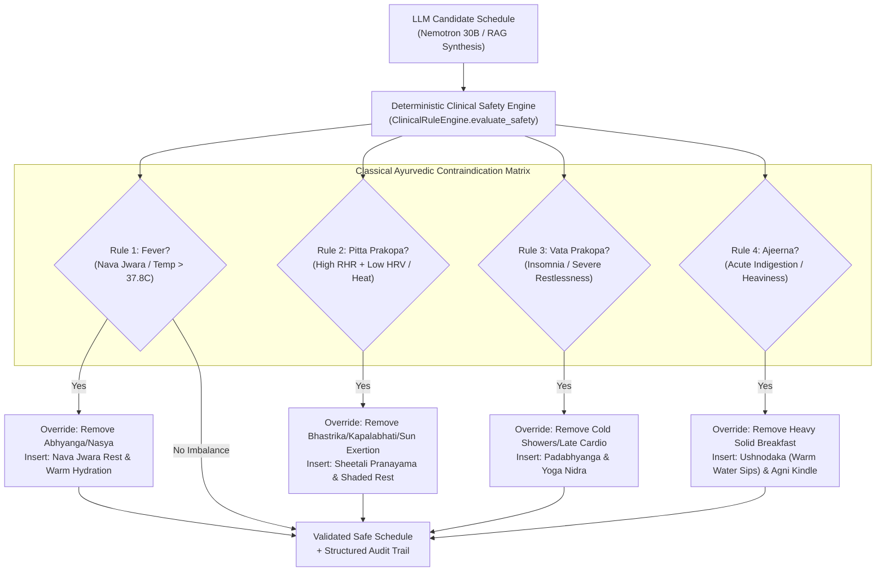

# AI Dincharya: Security and Deterministic Safety Specification

**Date:** October 15, 2026  
**Author:** AI Systems & Security Architect  
**Scope:** Cryptographic Authentication, Session Management, CORS Hardening, and Classical Ayurvedic Safety Matrix

---

## 1. Authentication & Cryptographic Security

Prior to this implementation sprint, user passwords were stored using raw, unsalted SHA-256 hashes (`hashlib.sha256(password.encode()).hexdigest()`), and bearer tokens were permanent, non-expiring strings stored in SQLite without server-side revocation. This sprint replaced this vulnerable implementation with an enterprise-grade cryptographic layer.

### 1.1 Password Hashing with Salted Bcrypt
All password hashing now utilizes `bcrypt` with unique cryptographically random salts:
```python
def hash_password(password: str) -> str:
    salt = bcrypt.gensalt()
    return bcrypt.hashpw(password.encode("utf-8"), salt).decode("utf-8")
```
- Algorithm: Blowfish-based adaptive hashing (`$2b$`).
- Work factor: 12 rounds (default `gensalt()`).
- Salting: Unique per-user random 128-bit salt prevents rainbow table and precomputation attacks.

### 1.2 Transparent Legacy Migration
To avoid breaking existing user accounts and test databases from earlier development phases, `db.authenticate_user()` provides automatic transparent migration:
1. When a user submits credentials, `verify_password()` detects whether the stored hash is bcrypt (`$2b$`/`$2a$`) or legacy 64-character hexadecimal SHA-256.
2. If the user presents valid credentials against a legacy SHA-256 hash, the system immediately hashes the plaintext password with salted bcrypt and updates the `users` record.
3. Subsequent logins verify against the upgraded bcrypt hash.

### 1.3 Session Expiry & Server-Side Revocation
- **Database Schema Migration:** The `sessions` table was migrated to include:
  ```sql
  expires_at REAL DEFAULT 0,
  is_revoked INTEGER DEFAULT 0
  ```
- **Session Duration:** Sessions are granted an explicit 24-hour expiration (`expires_at = time.time() + 86400.0`).
- **Token Verification:** `db.get_user_from_token(token)` strictly rejects:
  - Unknown tokens (`None`).
  - Revoked tokens (`is_revoked == 1`).
  - Expired tokens (`expires_at < time.time()`).
- **Server-Side Revocation:** The `POST /api/auth/logout` endpoint immediately sets `is_revoked = 1`, preventing reuse of intercepted tokens.

### 1.4 Cross-User Data Isolation
All state and notification queries enforce strict user boundary constraints:
- Notifications are queried strictly by authenticated `user_id`:
  ```sql
  SELECT * FROM notifications WHERE user_id = ? ORDER BY created_at DESC LIMIT ?
  ```
- Tool execution functions (`execute_planner_tool`) validate the `caller_user_id` against target parameters, rejecting cross-tenant modification attempts.

### 1.5 Application Hardening & CORS
- **Explicit CORS Allowlist:** Wildcard origins (`allow_origins=["*"]`) with `allow_credentials=True` were eliminated. Main now reads `CORS_ORIGINS` from environment variables, defaulting to explicit local frontend hosts:
  ```python
  allowed_origins = [
      "http://localhost:8000", "http://127.0.0.1:8000",
      "http://localhost:8001", "http://127.0.0.1:8001"
  ]
  ```
- **Configuration Validator:** `src/config.py:validate_config()` inspects the environment at FastAPI startup, reporting missing or weak keys.
- **Safe Environment Documentation:** `.env.example` contains sanitized documentation templates without production secrets.

---

## 2. Deterministic Clinical Safety Boundary

Ayurvedic wellness practices are powerful physiological modulators. Practices beneficial for one constitution or state (such as full-body oil massage or heating pranayama) are directly contraindicated during acute illness or specific doshic imbalances.

The AI Dincharya safety architecture enforces deterministic Python rule engines that **strictly override** any LLM-synthesized proposal. The LLM is never permitted to make final clinical safety decisions.



---

## 3. Classical Multi-Rule Contraindication Matrix

### Rule 1: Nava Jwara (Acute Fever / Febrile State)
- **Classical Foundation:** *Charaka Samhita (Chikitsa Sthana Ch. 3).* During early-stage fever (Nava Jwara), the digestive fire (Agni) is displaced outward, and bodily channels (Srotas) are blocked by toxic metabolic residue (Ama). Heavy oil applications (Abhyanga), nasal oil administration (Nasya), and vigorous exercise drive toxins deeper into tissues.
- **Trigger Conditions:** `vikriti_flags.has_fever == True` or `telemetry.body_temp_c > 37.8` or symptom report containing "fever".
- **Contraindicated Practices Removed:** `Abhyanga`, `Oil Massage`, `Nasya`, `Intense Cardio`, `High-Intensity Exercise`.
- **Prescribed Replacement Practice:** `Nava Jwara Rest & Hydration` (Gentle restorative rest, warm water sips, zero heavy exertion).

### Rule 2: Pitta Prakopa (Pitta Aggravation & Hyperacidity)
- **Classical Foundation:** *Sushruta Samhita (Sutra Sthana Ch. 21).* When Pitta dosha is aggravated (excess heat, acid, inflammatory intensity), hyper-ventilatory or heating practices exacerbate tissue irritation.
- **Trigger Conditions:** `vikriti_flags.pitta_aggravated == True` or symptoms containing "acid", "heartburn", "sunburn", "hyperacidity".
- **Contraindicated Practices Removed:** `Bhastrika Pranayama`, `Kapalabhati`, `Sun Salutations`, `Midday Intense Cardio`.
- **Prescribed Replacement Practice:** `Sheetali Pranayama & Shaded Rest` (Cooling breath through curled tongue and restorative cooling downtime).

### Rule 3: Vata Prakopa & Anidra (Vata Aggravation & Insomnia)
- **Classical Foundation:** *Ashtanga Hridaya (Sutra Sthana Ch. 11).* Vata imbalance manifests as irregular, cold, hyperactive, erratic energy resulting in insomnia (Anidra) and anxiety. Cold water shock and late-night vigorous exertion exacerbate nervous exhaustion.
- **Trigger Conditions:** `vikriti_flags.vata_aggravated == True` or symptoms containing "insomnia", "sleepless", "anxiety", "restless".
- **Contraindicated Practices Removed:** `Cold Shower`, `Cold Water Rinse`, `Late Night Cardio`, `Late Intense Workout`.
- **Prescribed Replacement Practice:** `Padabhyanga & Yoga Nidra` (Warm sesame oil applied to the soles of the feet followed by guided yogic sleep relaxation).

### Rule 4: Ajeerna (Acute Indigestion & Sluggish Agni)
- **Classical Foundation:** *Madhava Nidana (Ch. 6).* Consuming heavy, solid foods when the gastric fire is compromised produces toxic Ama.
- **Trigger Conditions:** Symptoms containing "indigestion", "bloating", "gas", "ajeerna", "heaviness".
- **Contraindicated Practices Removed:** `Heavy Breakfast`, `Solid Breakfast`, `Protein Rich Breakfast`.
- **Prescribed Replacement Practice:** `Ushnodaka (Warm Water Sips) & Agni Kindle` (Sipping boiled water with ginger to gently kindle digestive fire without overwhelming digestion).

---

## 4. Safety Audit Log Structure

Every evaluation produces a structured audit dictionary returned to the API layer and logged for diagnostic traceability:

```json
{
  "is_safe": false,
  "overrides_applied": [
    {
      "rule": "Nava Jwara (Fever) Override",
      "removed_practice": "Abhyanga",
      "replacement_practice": "Nava Jwara Rest & Hydration",
      "time_slot": "07:15 - 07:45",
      "clinical_rationale": "Classical Ayurvedic contraindication: Heavy oil massage (Abhyanga) is strictly prohibited during active fever (Nava Jwara) as it drives toxins deeper into bodily tissues."
    }
  ],
  "rules_checked": [
    "Rule 1: Nava Jwara (Fever) Contraindication",
    "Rule 2: Pitta Prakopa (Hyperacidity & Heat) Contraindication",
    "Rule 3: Vata Prakopa (Severe Insomnia & Restlessness) Contraindication",
    "Rule 4: Ajeerna (Acute Indigestion) Contraindication"
  ]
}
```
